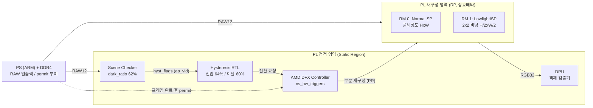
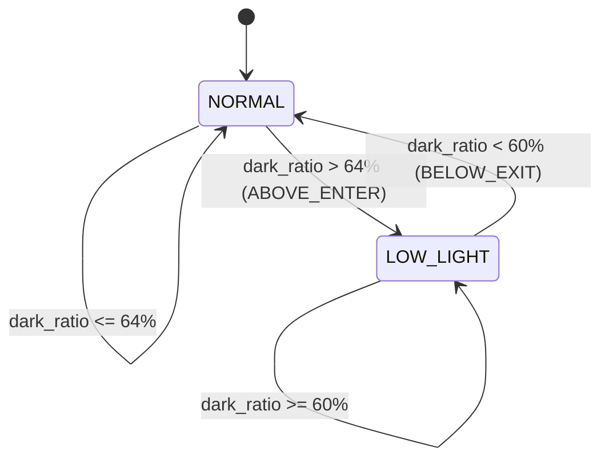
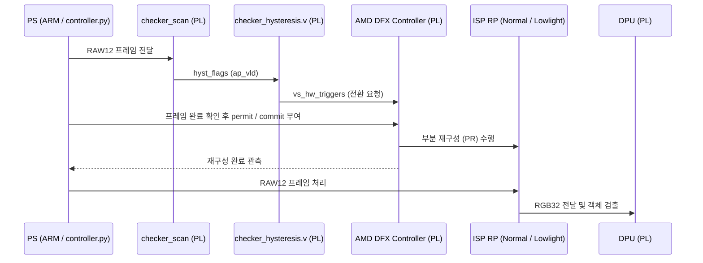

# Description — 연구 종합 문서

> **FPGA의 동적 부분 재구성을 이용한 조도 적응형 영상 처리 아키텍처**  
> `AMD ZCU104 (xczu7ev)` · `Vitis HLS / Vivado 2024.1` · `정본 dfxisp_essen → 정리본 dfxisp_v2`

<details open>
<summary><strong>📑 목차 바로가기</strong></summary>

- [기본 정보](#기본-정보)
- [연구 개요](#연구-개요)
  - [연구 배경과 문제](#연구-배경과-문제)
  - [연구 목적](#연구-목적)
  - [제안 구조](#제안-구조)
  - [구현과 검증 환경](#구현과-검증-환경)
  - [검증 현황 및 미확인 항목](#검증-현황-및-미확인-항목)
  - [연구 범위](#연구-범위)
- [연구 흐름](#연구-흐름)
- [1. HLS C++ 소스](#1-hls-c-소스)
  - [1.1 장면 조도 판정 (정적 영역 — Scene Checker)](#11-장면-조도-판정-정적-영역--scene-checker)
  - [1.2 일반 조도용 ISP RM (재구성 영역 — NormalISP)](#12-일반-조도용-isp-rm-재구성-영역--normalisp)
  - [1.3 저조도용 ISP RM (재구성 영역 — LowlightISP)](#13-저조도용-isp-rm-재구성-영역--lowlightisp)
  - [1.4 기준 모델 검증 데이터 (골든 벡터 CSV)](#14-기준-모델-검증-데이터-골든-벡터-csv)
  - [1.5 C-시뮬레이션 테스트](#15-c-시뮬레이션-테스트)

</details>

---

## 기본 정보

| 항목 | 내용 |
|---|---|
| **논문 제목** | FPGA의 동적 부분 재구성을 이용한 조도 적응형 영상 처리 아키텍처 |
| **학위 / 소속** | 석사 학위논문 (제주대학교 전자공학과) |
| **저자 / 지도교수** | 이형민 / 허재영 |
| **작성일 / 최종 수정일** | 2026-11-22 / 2026-11-23 |
| **대상 보드** | AMD ZCU104 (`xczu7ev-ffvc1156-2-e`) |
| **개발 도구** | Vitis HLS 2024.1, Vivado 2024.1 |
| **정본 / 정리 폴더** | `dfxisp_essen` (읽기 전용) / `dfxisp_v2` |

---

## 연구 개요

### 연구 배경과 문제

영상 기반 객체 검출기의 성능은 카메라 센서의 RAW(가공 전 원본) 데이터를 RGB로 변환하는 **ISP(Image Signal Processor)**의 출력 품질에 좌우된다. 저조도 환경에서는 광자 산탄 잡음과 읽기 잡음으로 신호 대 잡음비(SNR)가 급격히 낮아져, 주간 기준의 단일 ISP만으로는 대응하기 어렵다.

밝은 장면과 어두운 장면에 적합한 ISP는 **구조 자체가 다르다**. 저조도에서는 `2×2` 비닝(binning)으로 인접 화소를 결합해 SNR을 확보하고 노출 이득을 높이는 대신, 출력 해상도가 가로·세로 절반($H/2 \times W/2$)으로 줄어든다. 두 구조의 ISP를 FPGA에 상시 함께 배치(always-on)하면 사용하지 않는 회로의 자원까지 계속 점유하므로, 자원이 제한된 임베디드 환경에서는 비효율적이다.

### 연구 목적

> [!IMPORTANT]
> 본 연구의 주어는 **FPGA 동적 부분 재구성(DFX)** 하드웨어 아키텍처이며, 조도 적응형 영상 처리는 적용 분야다.  
> DFX는 검출 정확도를 직접 높이는 영상 알고리즘이 아니라, **단일 재구성 영역에 조도별 ISP를 시분할로 배치해 하드웨어 자원을 절감하는 구현 기법**이다.

본 연구는 장면 조도에 따라 서로 다른 ISP 회로를 실행 중에 교체하는 DFX 기반 아키텍처를 설계·구현하고, ZCU104 보드에서 종단 간 동작을 검증한다.

1. **동적 전환 아키텍처 실보드 검증** — 조도 판정 → 부분 재구성 → ISP 처리 → DPU 객체 검출 전 경로의 안정적 동작 확인
2. **자원 효율 및 성능 비저하 검증** — 상시 병렬 배치(always-on) 대비 FPGA 자원 절감 효과 확인 및 고정 ISP 구성 대비 검출 성능 비저하 확인

### 제안 구조

시스템은 **PS·DDR4**, **PL 정적 영역(Static Region)**, **PL 재구성 영역(RP, Reconfigurable Partition)**의 3개 계층으로 분리된다.



- **PS · DDR4:** RAW 프레임 입출력, 프레임 처리 완료 확인 후 전환 허가(`permit`/`commit`) 부여, 재구성 완료 관측 담당
- **PL 정적 영역:** 장면 판정기(`checker_scan` + `checker_hysteresis.v`), AMD DFX Controller, 객체 검출용 DPU 상주
  - RAW 도메인 어두운 화소 비율(`dark_ratio`, 중심 문턱값 `62%`)로 조도를 판정하고, 경계 떨림 방지를 위해 **진입 `64%` · 이탈 `60%`**의 Schmitt 히스테리시스 적용
- **PL 재구성 영역(RP):** 두 재구성 모듈(RM) 중 하나만 상호배타적으로 탑재
  - **`NormalISP`** (<kbd>일반 조도</kbd>): AMD Vitis Vision L3 `isppipeline` 단계 순서를 따라 `BLC → Bayer 이득 제어 → 3×3 양선형 디모자이킹 → Gray-World AWB → 3×3 CCM → 감마 보정` 수행 (`H×W` RGB 출력)
  - **`LowlightISP`** (<kbd>저조도</kbd>): `2×2 RAW 비닝·디모자이킹 결합 → BLC → 노출 이득(2.0×)·고정 WB → 3×3 CCM → 감마 보정` 수행 (`H/2×W/2` RGB 출력)

<details>
<summary><strong>🔀 조도 판정 히스테리시스 상태 전이도 & 전환 제어 시퀀스 보기</strong></summary>

#### Scene Checker Schmitt 히스테리시스 상태 전이



#### PL 하드웨어 트리거 · PS 안전 허가(permit) 협조 시퀀스



</details>

### 구현과 검증 환경

- **정수 기준 모델:** 모든 ISP 산술은 정수(bit-exact)로 설계하고 **HLS C++**를 기준 모델로 삼는다.
- **합성 및 호환성 검증:** Vitis HLS 2024.1로 각 RM과 판정기를 합성하고, Vivado 2024.1에서 DFX 구현 및 `pr_verify`로 두 RM의 정적 영역 호환성을 검증한다.
- **회귀 및 보드 검증:** 독립 구현에서 생성한 고정 골든 벡터 CSV와 C 시뮬레이션으로 대조한다. 보드 검증은 실제 센서 RAW 데이터셋(주간 PASCAL RAW, 야간 LOD RAW)을 파일로 순차 입력해 **고정 `NormalISP` / 고정 `LowlightISP` / 자동 전환(DFX)** 세 구성을 동일 검출기·동일 입력으로 비교한다.

### 검증 현황 및 미확인 항목

- [x] **보드 종단 동작 및 정확도 비교 (2026-10 ZCU104 실험)**[^1]  
  RAW 입력 → 장면 판정 → RM 전환 → ISP → DPU 검출(YOLOv8n, SSD-MobileNet) 전 경로 동작 확인. DFX 자동 전환의 정확도는 최선 고정 ISP와 동등 수준이었으며, 야간 mAP 향상의 주원인은 주·야간 균형 학습 모델로 확인됨.
- [x] **보드 재현 검증 (2026-11-19 YOLOv8n 재실행)**[^2]  
  10월 자동 전환 실험 재현 완료 — **600프레임** 순차 처리, **RM 전환 93회**, 600프레임 ISP 출력 해시 **100% 일치**.
- [ ] **자원 절감 정량 수치 재측정** — 현재 설계 기준 always-on 대비 자원 절감률 재측정 후 후속 절 기재 예정.
- [ ] **미확인 항목** — PR 전환 지연, 소비 전력, 새 장면 일반화 검증, 주간(day) 성능 유지 여부.

### 연구 범위

본 문서와 실험 검증의 경계는 다음과 같다.

- **포함 범위:** FPGA DFX 기반 조도 적응형 ISP 전환 아키텍처, `NormalISP`/`LowlightISP`의 HLS 구현, PL 장면 판정 및 PS 협조 전환 제어, 동일 DPU 검출기를 이용한 보드 동작·성능 비교.

> [!CAUTION]
> **제외 범위:** 객체 검출기의 학습·개선(동일 모델을 평가 도구로만 사용), 실시간 카메라 스트리밍 입력 환경에서의 처리량 및 프레임 유실 검증.

---

## 연구 흐름


> [!NOTE]
> 전체 진행은 단순 선형이 아니라, 하드웨어 구현이나 실센서 RAW 검증에서 새로운 사실이 드러날 때마다 **SW Stage 3으로 되돌아와 알고리즘·상수를 재검증한 뒤 다시 HW에 반영하는 나선형(spiral) 흐름**을 따랐다.[^3]

1. **문제 설정 및 아키텍처 정의 (`2026.07`)**  
   저조도 객체 검출 성능 저하를 SNR 문제와 ISP 구조 차이(풀해상도 vs 2×2 비닝·고이득)로 정식화했다. 정적 영역에는 제어·판정·DFX 컨트롤러만 두고, 단일 RP에 `NormalISP`와 `LowlightISP` 전체 파이프라인을 상호배타적으로 교체하는 아키텍처를 정본 구조로 확정했다.[^4]

2. **SW 트랙: 기준 모델·판정기·정확도 검증 (`Stage 0~3`, `2026.07~08`)**  
   정수(bit-exact) 산술 기준선을 고정하고, RAW 도메인 `dark16` 통계 기반 장면 판정기(중심 62%, 히스테리시스 진입 64%·이탈 60%)를 확정했다. 실제 센서 RAW(주간 PASCAL RAW, 야간 LOD RAW) 교차 검증을 통해 BLC 재보정(2/2), WB 모드 분리 기각(공통 유지), 톤 커브(감마 2.0), 2×2 비닝·디모자이킹 결합 구조를 정립했다.[^3][^5]

3. **HW 트랙: HLS 합성·검증 및 패브릭 DFX 구현 (`Stage 4~5`, `2026.07~08`)**  
   Vitis HLS 2024.1로 `NormalISP`, `LowlightISP`, `checker_scan`을 합성하고 C 시뮬레이션 및 C/RTL 공동 시뮬레이션을 수행했다. 이어 Vivado 2024.1에서 패브릭 단위 DFX 구현, `pr_verify` 호환성 검증, 정적 영역 히스테리시스 모듈(`checker_hysteresis.v`) 기반 하드웨어 트리거 체인 시뮬레이션을 완료했다.[^3][^5]

4. **ZCU104 보드 통합 및 실보드 검증 (`2026.09~10`)**  
   9월 23일 1단계 보드 통합 DFX에서 HLS IP 래퍼 단위 RP 경계로 소프트웨어 트리거 기반 `pr_verify` 통과와 부분 비트스트림 생성을 확인했다.[^6] 이어 10월 8일 DPU·Scene Checker·히스테리시스 RTL·DFX Controller를 통합한 블록 디자인(BD) 게이트 전 단계를 통과하고 PetaLinux와 `BOOT.BIN`을 구성했다.[^7] 10월 ZCU104 실보드 실험에서는 잠긴 정적 영역 위에 `BLC_LEVEL12=16`을 반영한 `LowlightISP` RM을 재빌드해 탑재하고, 주간·야간·혼합 RAW에 대해 고정 `NormalISP`, 고정 `LowlightISP`, 자동 전환(DFX) 세 구성을 YOLOv8n과 SSD-MobileNet(SE 블록 양자화 오류 수정 포함)으로 비교했다.[^1]

5. **재현 검증, 후속 비교 및 정리 (`2026.11~현재`)**  
   11월 19일 ZCU104에서 10월 YOLOv8n 자동 전환 실험을 재현해 600프레임 순차 처리, RM 전환 93회, 600프레임 ISP 출력 해시 및 검출 레코드 2,400건의 보관본 일치를 확인했다.[^2] 11월 20일에는 `Normal` / `Lowlight 2×2` / `Lowlight 4×4` 비닝 3방식 비교 및 HLS C-합성 후속 실험을 수행했다.[^8] 현재는 정본(`dfxisp_essen`)의 핵심 산출물을 `dfxisp_v2`로 선별·이관 중이며, 현재 설계 기준 always-on 대비 자원 절감 정량 수치 재측정이 후속 과제로 남아 있다.

---

## 1. HLS C++ 소스

```text
dfxisp_v2/
├── NormalISP/
│   ├── NormalISP.hpp               # 🟢 v2 존재 (RP 공통 포트 계약)
│   └── NormalISP.cpp               # 🟢 v2 존재 (정본과 바이트 동일)
├── LowlightISP/
│   ├── LowlightISP.hpp             # 🟢 v2 존재 (RP 공통 포트 계약)
│   └── LowlightISP.cpp             # 🟢 v2 존재 (정본과 바이트 동일)
├── vectors/
│   ├── NormalISP_vectors.csv       # 🟢 v2 존재 (10 cases, RAW 528 / RGB 528)
│   └── LowlightISP_vectors.csv     # 🟢 v2 존재 (11 cases, RAW 592 / RGB 147)
├── checker/                        # 🟡 v2 미복사 — 정본 대조 병기 (확인 필요)
└── (C-sim 테스트 파일)              # 🟡 v2 미복사 — 정본 대조 병기 (확인 필요)
```

> [!NOTE]
> `checker` HLS 소스 및 C-sim 테스트 파일은 현재 `dfxisp_v2`에 포함되어 있지 않으므로, 정본(`dfxisp_essen`)에서 직접 확인한 내용을 병기하고 `v2` 편입 여부는 `(확인 필요)`로 표시한다.

---

### 1.1 장면 조도 판정 (정적 영역 — Scene Checker)

#### `checker/checker.hpp` · 🟡 *v2 미복사 (`dfxisp_essen/checker/checker.hpp` 확인) — v2 편입 여부 `(확인 필요)`*

정적 영역 장면 판정기의 핵심 로직 헤더로, 외부 헤더 의존성 없이 열거형을 인라인 정의한다.

- **모드 및 플래그:** <kbd>NORMAL (0)</kbd>, <kbd>LOW_LIGHT (1)</kbd>, <kbd>AUTO (2)</kbd> / <kbd>ABOVE_ENTER (1&lt;&lt;0)</kbd>, <kbd>BELOW_EXIT (1&lt;&lt;1)</kbd>
- **정수 판정식 (`checker_select_mode`, `AUTO` 모드, $N = W \times H$):**

$$\text{dark} = \sum_{i=0}^{N-1} \mathbb{I}\!\left(\text{raw}[i] < T_{\text{dark}}\right)$$

$$\text{dark} \times 100 > 64 \cdot N \;\Rightarrow\; \texttt{ABOVE\_ENTER}, \qquad \text{dark} \times 100 < 60 \cdot N \;\Rightarrow\; \texttt{BELOW\_EXIT}, \qquad \text{dark} \times 100 > 62 \cdot N \;\Rightarrow\; \texttt{LOW\_LIGHT}$$

<details>
<summary><strong>📋 상세 스펙 (핵심 상수 · 오버로드 · 입출력)</strong></summary>

- **핵심 상수:** `DARK_RATIO_PCT=62`, `HYST_ENTER_PCT=64`, `HYST_EXIT_PCT=60`, `LOOP_TRIPCOUNT min=16 max=2073600`
- **강제 모드 동작:** <kbd>NORMAL</kbd> / <kbd>LOW_LIGHT</kbd> 입력 시 `dark_count=0`과 대응 플래그를 즉시 반환 (`checker_select_mode` 2개 오버로드)
- **입출력:** 입력 `raw(uint16_t*)`, `width`, `height`, `mode`, `dark_pixel_threshold`, `verdict_pct`, `enter_pct`, `exit_pct` / 출력 반환값(선택 모드), `hyst_flags`, `dark_count`
- **비고:** 실운용 `dark_pixel_threshold`($T_{\text{dark}}$)는 파일 내부 상수로 고정되어 있지 않고 `s_axilite` 런타임 인자로 전달됨 — 보드 실운용값 `(확인 필요)`

</details>

#### `checker/checker.cpp` · 🟡 *v2 미복사 (`dfxisp_essen/checker/checker.cpp` 확인, `hls/src/checker.cpp`와 바이트 동일) — v2 편입 여부 `(확인 필요)`*

정적 영역 장면 판정기의 HLS 합성 최상위 함수 `checker_scan` 래퍼다. `!raw_bayer || width <= 0 || height <= 0` 가드 시 `selected_mode=NORMAL`, `hyst_flags=BELOW_EXIT`, `dark_count=0`을 즉시 반환한다.

```cpp
extern "C" void checker_scan(
    const uint16_t* raw_bayer, int width, int height, int mode,
    uint16_t dark_pixel_threshold,
    int verdict_pct, int enter_pct, int exit_pct,
    int* selected_mode, int* hyst_flags, int* dark_count);
```

<details>
<summary><strong>🔌 HLS 인터페이스 상세</strong></summary>

- `raw_bayer`: `m_axi`, `bundle=gmem0`, `offset=slave`, `depth=2048`, `max_widen_bitwidth=128` + `s_axilite`
- 제어 입출력(`width`, `height`, `mode`, `dark_pixel_threshold`, `verdict_pct`, `enter_pct`, `exit_pct`, `selected_mode`, `dark_count`, `return`): `s_axilite`, `bundle=control`
- `hyst_flags`: `ap_vld` (후단 RTL 히스테리시스 블록 `checker_hysteresis.v` 직결용)

</details>

---

### 1.2 일반 조도용 ISP RM (재구성 영역 — NormalISP)

#### `NormalISP/NormalISP.hpp` · 🟢 *v2 존재*

밝은 장면에서 로드되는 일반 조도용 ISP RM 헤더로, `LowlightISP()`와 **6개 매개변수의 타입·순서가 동일한 RP 슬롯 공통 포트 계약**을 정의한다.

```cpp
// 보드 / DFX RM 최상위 (NormalISP · LowlightISP 동일 시그니처)
extern "C" void NormalISP(
    const uint16_t* raw_bayer, uint32_t* rgb_out,
    int width, int height, int* out_width, int* out_height);
```

- **추가 선언:** 열거형 `NormalISPAwbMode` (<kbd>NORMAL_ISP_AWB_OFF=0</kbd>, <kbd>NORMAL_ISP_AWB_ON=1</kbd>), 개발·분석용 `NormalISP_dev(..., int awb_mode, int* out_width, int* out_height)`

#### `NormalISP/NormalISP.cpp` · 🟢 *v2 존재 (`dfxisp_essen/NormalISP/NormalISP.cpp`와 바이트 동일)*

일반 조도용 ISP RM의 정수 연산 HLS 구현(`run_normal_isp`)이다. 최상위 `NormalISP`는 <kbd>AWB_ON</kbd> 고정이며 입력 해상도($H \times W$)를 보존한다.

```text
RAW12 (RGGB)
  → ① Bayer BLC (level=32, *258>>8)
  → ② Bayer 위치별 이득 (R=286, G=256, B=307, Q8)
  → ③ 3×3 양선형 디모자이킹 (12-bit 유지)
  → ④ Gray-World AWB (1차 스캔 평균, [64, 1024] 클램프)
  → ⑤ 3×3 CCM (음수 0 바닥처리 후 >>8)
  → ⑥ 12→8-bit (>>4) + 감마 2.0 LUT[256]
  → ⑦ RGB32 (0x00RRGGBB, H×W)
```

- **핵심 연산식:** BLC 복원 $\text{clip}(\lfloor(\max(v-32,0)\cdot 258)/256\rfloor, 0, 4095)$, 감마 LUT $\gamma(v_8) = \lfloor\sqrt{255 \cdot v_8}\rfloor$

<details>
<summary><strong>📋 상세 스펙 (처리 세부 · 핵심 상수 · HLS 인터페이스)</strong></summary>

- **처리 세부:**
  - 위치별 이득: 경계 외 좌표는 `[0, width-1]`/`[0, height-1]`로 복제, `[0, 4095]` 클램프
  - AWB: `AWB_ON` 시 별도 1차 스캔으로 보정 Bayer의 R/G/B 평균을 구해 `gain_r=(mean_g*256)/mean_r`, `gain_b=(mean_g*256)/mean_b`를 `[64, 1024]`로 클램프해 디모자이킹 후 R/B에 적용(`AWB_OFF` 시 256 바이패스)
  - 가드: null 또는 비양수 크기 입력 시 `out_width=out_height=0` 반환
- **핵심 상수:** `RAW12_MAX=4095`, `BLC_LEVEL12=32`(`2<<4`), `BLC_MUL_Q8=258`, `GAIN_R_Q8=286`, `GAIN_B_Q8=307`, `AWB_GAIN_MIN_Q8=64`, `AWB_GAIN_MAX_Q8=1024`, `CCM_Q8={{288,-24,-8},{-24,296,-16},{-16,-32,304}}`(각 행 합 256), `GAMMA2_LUT[256]`(`0..255`), `LOOP_TRIPCOUNT` y `4..1080` / x `4..1920`
- **HLS 인터페이스:** `raw_bayer`(`m_axi gmem0`, `depth=2048`) → `rgb_out`(`m_axi gmem1`, `depth=2048`), 스칼라 입출력 및 `return`은 `s_axilite control`

</details>

---

### 1.3 저조도용 ISP RM (재구성 영역 — LowlightISP)

#### `LowlightISP/LowlightISP.hpp` · 🟢 *v2 존재*

어두운 장면에서 로드되는 저조도용 ISP RM 헤더로, `NormalISP()`와 동일한 RP 슬롯 포트 시그니처를 유지한다.

```cpp
// 보드 / DFX RM 최상위 (NormalISP와 동일 RP 슬롯 시그니처)
extern "C" void LowlightISP(
    const uint16_t* raw_bayer, uint32_t* rgb_out,
    int width, int height, int* out_width, int* out_height);
```

- **추가 선언:** 열거형 `LowlightISPBinning` (<kbd>LOWLIGHT_ISP_BIN_SUBSAMPLE=0</kbd>, <kbd>LOWLIGHT_ISP_BIN_BINNING=1</kbd>), 개발·분석용 `LowlightISP_dev(..., int bin_mode, int* out_width, int* out_height)`

#### `LowlightISP/LowlightISP.cpp` · 🟢 *v2 존재 (`dfxisp_essen/LowlightISP/LowlightISP.cpp`와 바이트 동일)*

저조도용 ISP RM의 정수 연산 HLS 구현(`run_lowlight_isp`)이다. 최상위 `LowlightISP`는 <kbd>BINNING</kbd> 고정이며 출력 해상도는 절반으로 축소된다.

```text
RAW12 (RGGB)
  → ① 2×2 비닝·디모자이킹 결합 (R=sum_r/4, G=sum_g/8, B=sum_b/4)
  → ② RGB 도메인 BLC (level=16, *257>>8) + 노출 이득(2.0×)·고정 WB 결합
  → ③ 3×3 CCM (음수 0 바닥처리 후 >>8)
  → ④ 12→8-bit (>>4) + 감마 2.0 LUT[256]
  → ⑤ RGB32 (0x00RRGGBB, H/2×W/2)
```

- **핵심 연산식:** 출력 해상도 $W_{\text{out}} = \max(1, \lfloor W/2 \rfloor),\; H_{\text{out}} = \max(1, \lfloor H/2 \rfloor)$, BLC 복원 $\text{clip}(\lfloor(\max(v-16,0)\cdot 257)/256\rfloor, 0, 4095)$

<details>
<summary><strong>📋 상세 스펙 (처리 세부 · 핵심 상수 · HLS 인터페이스)</strong></summary>

- **처리 세부:**
  - 비닝·디모자이킹: `BINNING(1)`은 2×2 인접 RGGB 셀 경계 클램프 후 동일 색 평균(`R=sum_r/4`, `G=sum_g/8`, `B=sum_b/4`), `SUBSAMPLE(0)`은 단일 RGGB 셀(`R=r`, `G=(g0+g1)/2`, `B=b`)
  - 이득 및 WB: `gain_q8=(512*wb_q8)>>8`, `[0, 4095]` 클램프(적응형 AWB 없음)
  - 가드: null 또는 비양수 크기 입력 시 `out_width=out_height=0` 반환
- **핵심 상수:** `RAW12_MAX=4095`, `BLC_LEVEL12=16`(`1<<4`), `BLC_MUL_Q8=257`, `EXPOSURE_GAIN_Q8=512`(2.0×), `WB_R_Q8=286`, `WB_G_Q8=256`, `WB_B_Q8=307`, `CCM_Q8={{288,-24,-8},{-24,296,-16},{-16,-32,304}}`, `GAMMA2_LUT[256]`(`NormalISP.cpp`와 바이트 동일, `0..255`), 내측 루프 `#pragma HLS PIPELINE II=1`, `LOOP_TRIPCOUNT` y `1..540` / x `2..960`
- **HLS 인터페이스:** `raw_bayer`(`m_axi gmem0`, `depth=2048`) → `rgb_out`(`m_axi gmem1`, `depth=2048`), 스칼라 입출력 및 `return`은 `s_axilite control`

</details>

---

### 1.4 기준 모델 검증 데이터 (골든 벡터 CSV)

독립 Python 구현에서 생성해 고정한 비트 단위 회귀 검증 픽스처다.

- **`vectors/NormalISP_vectors.csv`** · 🟢 *v2 존재 (`dfxisp_essen/hls/tests/default_isp_golden_vectors.csv`와 바이트 동일)*  
  **10개 케이스** · 입력 RAW **528화소** / 기대 RGB(`0x00RRGGBB`) **528화소** (해상도 보존, `awb_mode` 0/1 포함)
  <details>
  <summary>열 구조 및 케이스 상세</summary>

  - 열 구조: `case,in_w,in_h,awb_mode,out_w,out_h,kind,idx,val`
  - 케이스: `8×8` 8개(`flat_mid_awb_off/on`, `flat_dark_awb_on`, `gradient_awb_off/on`, `blue_cast_awb_off/on`, `saturated_awb_on`), `5×3` 1개(`odd_dims_awb_on`), `1×1` 1개(`one_pixel_awb_on`)

  </details>

- **`vectors/LowlightISP_vectors.csv`** · 🟢 *v2 존재 (`dfxisp_essen/hls/tests/lowlight_isp_golden_vectors.csv`와 바이트 동일)*  
  `BLC=16` 반영본 · **11개 케이스** · 입력 RAW **592화소** / 기대 RGB(`0x00RRGGBB`) **147화소** (절반 해상도, `bin_mode` 0/1 포함)
  <details>
  <summary>열 구조 및 케이스 상세</summary>

  - 열 구조: `case,in_w,in_h,bin_mode,out_w,out_h,kind,idx,val`
  - 케이스: `8×8→4×4` 9개(`flat_mid`, `flat_dark`, `flat_near_floor`, `gradient`, `gradient_subsample`, `noisy_dark`, `noisy_dark_subsample`, `hard_edge`, `saturated`), `5×3→2×1` 1개(`odd_dims`), `1×1→1×1` 1개(`one_pixel`)

  </details>

---

### 1.5 C-시뮬레이션 테스트

> [!WARNING]
> 아래 3개 항목은 현재 `dfxisp_v2`에 복사되어 있지 않다. `v2` 편입 및 정본 함수 연동 여부는 `(확인 필요)` 상태다.

- **`NormalISP` C-sim 테스트** · 🟡 *v2 미복사 — v2 편입 및 정본 함수 연동 여부 `(확인 필요)`*
  - `dfxisp_essen/NormalISP/NormalISP_tb.cpp`: 정본 `NormalISP`/`NormalISP_dev` 대상 구조·정상성 7항목(해상도 보존·`0x00RRGGBB`, null/0 가드, 평탄 입력 내부 균일성, G 램프 단조성, 포화 4095 클램프·무채색 근접성, AWB ON/OFF 색편향 축소, `NormalISP()==NormalISP_dev(AWB_ON)`) 검사. **골든 CSV 미로드.**
  - `dfxisp_essen/hls/tests/test_default_isp_csim.cpp` + `golden_csv.hpp`: 골든 CSV 비트 일치 대조 및 스모크 테스트(페데스탈 32→0, AWB, CCM 중립, 포화, 가드 등)를 수행하나, 정본 `NormalISP`가 아닌 중복 사본 함수(`default_isp`, `rm_default_isp_top`) 호출.

- **`LowlightISP` C-sim 테스트** · 🟡 *v2 미복사 — v2 편입 및 정본 함수 연동 여부 `(확인 필요)`*
  - `dfxisp_essen/LowlightISP/LowlightISP_tb.cpp`: 정본 `LowlightISP`/`LowlightISP_dev` 대상 구조·정상성 7항목(`bin_dim` 해상도·`0x00RRGGBB`, null/0 가드, 평탄 입력 전 화소 균일성, G 램프 단조성, 포화 4095→`0x00FFFFFF` 정확 일치, `BINNING` vs `SUBSAMPLE` 차이, `LowlightISP()==LowlightISP_dev(BINNING)`) 검사. **골든 CSV 미로드.**
  - `dfxisp_essen/hls/tests/test_lowlight_isp_csim.cpp` + `golden_csv.hpp`: 골든 CSV 비트 일치 대조 및 스모크 테스트(페데스탈 16→0, 감마 비선형 리프트, 비닝 잡음 분산 감소, 포화, 가드 등)를 수행하나, 정본 `LowlightISP`가 아닌 중복 사본 함수(`lowlight_isp`, `rm_lowlight_isp_top`) 호출.

- **`checker` C-sim 테스트** · 🟡 *v2 미복사 — v2 편입 및 골든 어서션 테스트 유무 `(확인 필요)`*
  - `dfxisp_essen/hls/results/tools/checker_hls_tb.cpp`(+ `checker_hls_csim_tb.cpp`): 매니페스트 CSV(`raw_path,width,height,stem,source`)로 실제 RAW 바이너리 파일을 읽어 `checker_scan(..., DFXISP_MODE_AUTO, 4096, 62, 64, 60, ...)`의 `dark_count`, `hyst_flags`, `selected_mode`를 CSV로 출력하는 배치 실행 하네스. 고정 골든 벡터 대조 어서션 테스트는 `dfxisp_essen`에서 확인되지 않음 `(확인 필요)`.

---

[^1]: 2026-10 ZCU104 보드 실험 정본 기록: `dfxisp_essen/2026-10-v2-board/README.md`
[^2]: 2026-11-19 YOLOv8n 보드 재현 검증 기록: `dfxisp_essen/STATUS.md`
[^3]: Stage 0~6 및 나선형 되먹임 기록: `dfxisp_essen/ROADMAP.md`
[^4]: 정본 아키텍처 및 시스템 사양서: `dfxisp_essen/README.md`, `dfxisp_essen/SPEC.md`
[^5]: 전체 실험 종합 표(EXP-01~43): `dfxisp_essen/DFXISP_실험_종합정리.csv`
[^6]: 1단계 보드 통합 DFX 결과(2026-09-23): `dfxisp_essen/DFX/RESULTS.md`
[^7]: 통합 BD 게이트 통과 산출물(2026-10-08): `dfxisp_essen/unified_final_v2/gate_exit.json`
[^8]: 2026-11-20 비닝 3방식 비교 및 HLS C-합성 실험: `dfxisp_essen/binning_3way_20261120/`
