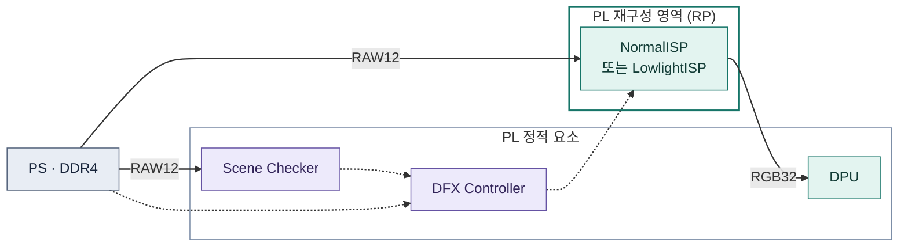
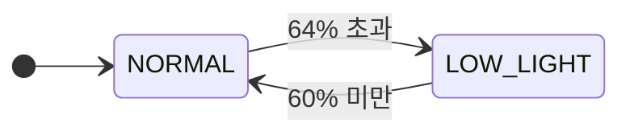
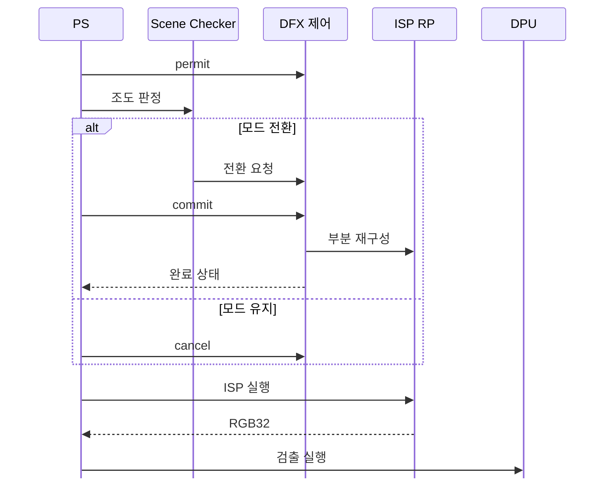
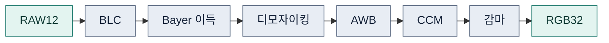
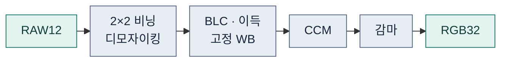

# Description — 연구 종합 문서

> **FPGA의 동적 부분 재구성을 이용한 조도 적응형 영상 처리 아키텍처**  
> `AMD ZCU104 (xczu7ev)` · `Vitis HLS / Vivado 2024.1` · `정본 dfxisp_essen → 정리본 dfxisp_v2`

<details open>
<summary><strong>📑 목차 바로가기</strong></summary>

- [기본 정보](#기본-정보)
- [연구 개요](#연구-개요)
  - [연구 배경과 문제](#연구-배경과-문제)
  - [연구 목적](#연구-목적)
  - [제안 구조](#제안-구조)
  - [구현과 검증 환경](#구현과-검증-환경)
  - [검증 현황 및 미확인 항목](#검증-현황-및-미확인-항목)
  - [연구 범위](#연구-범위)
- [연구 흐름](#연구-흐름)
- [1. ISP](#1-isp)
  - [1.1 일반 조도용 ISP RM (재구성 영역 — NormalISP)](#11-일반-조도용-isp-rm-재구성-영역--normalisp)
  - [1.2 저조도용 ISP RM (재구성 영역 — LowlightISP)](#12-저조도용-isp-rm-재구성-영역--lowlightisp)
  - [1.3 기준 모델 검증 데이터 (기준 벡터 CSV)](#13-기준-모델-검증-데이터-기준-벡터-csv)
  - [1.4 테스트와 합성 결과](#14-테스트와-합성-결과)
- [2. DFX](#2-dfx)
  - [2.1 장면 조도 판정 (PL 정적 요소 — Scene Checker)](#21-장면-조도-판정-pl-정적-요소--scene-checker)
  - [2.2 PL 정적 요소: DFX 전환 제어, 안전, ICAP 브리지](#22-pl-정적-요소-dfx-전환-제어-안전-icap-브리지-dfx_shell)
  - [2.3 DFX 구현과 최종 연결 구조](#23-dfx-구현과-최종-연결-구조)
  - [2.4 checker 테스트](#24-checker-테스트)
- [3. AI](#3-ai)
  - [3.1 모델과 DPU 구성](#31-모델과-dpu-구성)
  - [3.2 학습 기록](#32-학습-기록)
  - [3.3 양자화와 컴파일 재구축](#33-양자화와-컴파일-재구축)
  - [3.4 보드 DPU 추론 확인](#34-보드-dpu-추론-확인)
  - [3.5 DPU IP 설정](#35-dpu-ip-설정)
  - [3.6 10월 실험에서의 모델 역할](#36-10월-실험에서의-모델-역할)
  - [3.7 한계와 미확인 항목](#37-한계와-미확인-항목)
- [4. PetaLinux](#4-petalinux)
- [5. End-to-End](#5-end-to-end)

</details>

---

## 기본 정보

| 항목 | 내용 |
|---|---|
| **논문 제목** | FPGA의 동적 부분 재구성을 이용한 조도 적응형 영상 처리 아키텍처 |
| **학위 / 소속** | 석사 학위논문 (제주대학교 전자공학과) |
| **저자 / 지도교수** | 이형민 / 허재영 |
| **작성일 / 최종 수정일** | 2026-11-22 / 2026-11-23 |
| **대상 보드** | AMD ZCU104 (`xczu7ev-ffvc1156-2-e`) |
| **개발 도구** | Vitis HLS 2024.1, Vivado 2024.1 |
| **정본 / 정리 폴더** | `dfxisp_essen` (읽기 전용) / `dfxisp_v2` |

---

## 연구 개요

### 연구 배경과 문제

영상 기반 객체 검출기의 성능은 카메라 센서의 RAW(가공 전 원본) 데이터를 RGB로 변환하는 **ISP(Image Signal Processor)**의 출력 품질에 좌우된다. 저조도 환경에서는 광자 산탄 잡음과 읽기 잡음으로 신호 대 잡음비(SNR)가 급격히 낮아져, 주간 기준의 단일 ISP만으로는 대응하기 어렵다.

밝은 장면과 어두운 장면에 적합한 ISP는 **구조 자체가 다르다**. 저조도에서는 `2×2` 비닝(binning)으로 인접 화소를 결합해 SNR을 확보하고 노출 이득을 높이는 대신, 출력 해상도가 가로·세로 절반($H/2 \times W/2$)으로 줄어든다. 두 구조의 ISP를 FPGA에 상시 함께 배치(always-on)하면 사용하지 않는 회로의 자원까지 계속 점유하므로, 자원이 제한된 임베디드 환경에서는 비효율적이다.

### 연구 목적

> [!IMPORTANT]
> 본 연구의 주어는 **FPGA 동적 부분 재구성(DFX)** 하드웨어 아키텍처이며, 조도 적응형 영상 처리는 적용 분야다.  
> DFX는 검출 정확도를 직접 높이는 영상 알고리즘이 아니라, **단일 재구성 영역에 조도별 ISP를 시분할로 배치해 하드웨어 자원을 절감하는 구현 기법**이다.

본 연구는 장면 조도에 따라 서로 다른 ISP 회로를 실행 중에 교체하는 DFX 기반 아키텍처를 설계·구현하고, ZCU104 보드에서 종단 간 동작을 검증한다.

1. **동적 전환 아키텍처 실보드 검증** — 조도 판정 → 부분 재구성 → ISP 처리 → DPU 객체 검출 전 경로의 안정적 동작 확인
2. **자원 효율 및 성능 비저하 검증** — 상시 병렬 배치(always-on) 대비 FPGA 자원 절감 효과 확인 및 고정 ISP 구성 대비 검출 성능 비저하 확인

### 제안 구조

시스템은 **PS·DDR4**, **PL 정적 요소(Static Logic)**, **PL 재구성 영역(RP, Reconfigurable Partition)**의 3개 계층으로 분리된다.



**그림 1. 조도 적응형 ISP의 DFX 아키텍처.** 실선은 영상 데이터 흐름, 점선은 판정·전환 제어 흐름을 나타낸다.

- **PS · DDR4**는 RAW 프레임과 ISP 출력을 관리한다. 보드 실험에서는 PS가 DDR4의 RGB32 출력을 읽어 전처리한 뒤 DPU에 전달한다.
- **PL 정적 요소**의 Scene Checker는 `checker_scan`과 히스테리시스 RTL로 구성된다. `checker_scan`은 어두운 화소 비율을 계산하고 `hyst_flags`를 `ap_vld`와 함께 RTL에 전달한다. 안정 모드가 바뀌면 전환 요청이 생성되고, PS가 전환을 승인하면 DFX Controller가 부분 재구성을 수행한다.
- **PL 재구성 영역(RP)**에는 두 재구성 모듈(RM) 중 하나만 탑재된다.
  - **`NormalISP`** (<kbd>일반 조도</kbd>): AMD Vitis Vision L3 `isppipeline` 단계 순서를 따라 `BLC → Bayer 이득 제어 → 3×3 양선형 디모자이킹 → Gray-World AWB → 3×3 CCM → 감마 보정` 수행 (`H×W` RGB 출력)
  - **`LowlightISP`** (<kbd>저조도</kbd>): `2×2 RAW 비닝·디모자이킹 결합 → BLC → 노출 이득(2.0×)·고정 WB → 3×3 CCM → 감마 보정` 수행 (`H/2×W/2` RGB 출력)

<details>
<summary><strong>🔀 조도 판정 히스테리시스 상태 전이도 & 전환 제어 시퀀스 보기</strong></summary>

#### Scene Checker Schmitt 히스테리시스 상태 전이



**그림 2. Scene Checker의 Schmitt 히스테리시스.** 어두운 화소 비율이 64%를 초과하면 저조도 모드로 진입하고(`ABOVE_ENTER`), 60% 미만이면 일반 조도 모드로 돌아간다(`BELOW_EXIT`). 중심 문턱값은 62%이며, 60%와 64%를 포함한 구간에서는 현재 모드를 유지한다. 리셋 시 초기 모드는 `NORMAL`이다.

#### PL 하드웨어 트리거 · PS 안전 허가(permit) 협조 시퀀스



**그림 3. 프레임 사이의 RM 전환과 ISP 실행.** PS의 `controller.py`는 직전 프레임이 끝나고 ISP가 유휴 상태임을 확인한 뒤 `permit`을 설정하고 조도 판정을 시작한다. 전환 요청이 생기면 PS가 대상 RM을 확인하고 `commit`을 보낸다. DFX 제어 블록은 안전 게이트와 DFX Controller를 묶어 나타내며, 승인된 요청은 `vs_hw_triggers`를 통해 부분 재구성을 시작한다. PS는 재구성이 끝나거나 전환 요청 없이 판정이 끝나면 `permit`을 해제하고 ISP를 실행한다.

</details>

### 구현과 검증 환경

- **정수 기준 모델:** 모든 ISP 산술은 정수(bit-exact)로 설계하고 **HLS C++**를 기준 모델로 삼는다.
- **합성 및 호환성 검증:** Vitis HLS 2024.1로 각 RM과 판정기를 합성하고, Vivado 2024.1에서 DFX 구현 및 `pr_verify`로 두 RM의 PL 정적 요소 호환성을 검증한다.
- **회귀 및 보드 검증:** 독립 구현에서 생성한 고정 기준 벡터 CSV와 C 시뮬레이션으로 대조한다. 보드 검증은 실제 센서 RAW 데이터셋(주간 PASCAL RAW, 야간 LOD RAW)을 파일로 순차 입력해 **고정 `NormalISP` / 고정 `LowlightISP` / 자동 전환(DFX)** 세 구성을 동일 검출기·동일 입력으로 비교한다.

### 검증 현황 및 미확인 항목

- [x] **보드 종단 동작 및 정확도 비교 (2026-10 ZCU104 실험)**[^1]  
  RAW 입력 → 장면 판정 → RM 전환 → ISP → DPU 검출(YOLOv8n, SSD-MobileNet) 전 경로 동작 확인. DFX 자동 전환의 정확도는 최선 고정 ISP와 동등 수준이었으며, 야간 mAP 향상의 주원인은 주·야간 균형 학습 모델로 확인됨.
- [x] **보드 재현 검증 (2026-11-19 YOLOv8n 재실행)**[^2]  
  10월 자동 전환 실험 재현 완료 — **600프레임** 순차 처리, **RM 전환 93회**, 600프레임 ISP 출력 해시 **100% 일치**.
- [ ] **자원 절감 정량 수치 재측정** — 현재 설계 기준 always-on 대비 자원 절감률 재측정 후 후속 절 기재 예정.
- [ ] **미확인 항목** — PR 전환 지연, 소비 전력, 새 장면 일반화 검증, 주간(day) 성능 유지 여부.

### 연구 범위

본 문서와 실험 검증의 경계는 다음과 같다.

- **포함 범위:** FPGA DFX 기반 조도 적응형 ISP 전환 아키텍처, `NormalISP`/`LowlightISP`의 HLS 구현, PL 장면 판정 및 PS 협조 전환 제어, 동일 DPU 검출기를 이용한 보드 동작·성능 비교.

> [!CAUTION]
> **제외 범위:** 객체 검출기의 학습·개선(동일 모델을 평가 도구로만 사용), 실시간 카메라 스트리밍 입력 환경에서의 처리량 및 프레임 유실 검증.

---

## 연구 흐름


**그림 4. 연구 단계와 SW·HW 반복 검증.** 점선은 HW 구현이나 실센서 RAW 검증에서 얻은 결과를 바탕으로 SW Stage 3에서 알고리즘·상수를 재검증하고, 그 결과를 HW에 다시 반영한 과정을 나타낸다.[^3]

1. **문제 설정 및 아키텍처 정의 (`2026.07`)**  
   저조도 객체 검출 성능 저하를 SNR 문제와 ISP 구조 차이(풀해상도 vs 2×2 비닝·고이득)로 정식화했다. PL 정적 요소에는 제어·판정·DFX 컨트롤러만 두고, 단일 RP에 `NormalISP`와 `LowlightISP` 전체 파이프라인을 상호배타적으로 교체하는 아키텍처를 정본 구조로 확정했다.[^4]

2. **SW 트랙: 기준 모델·판정기·정확도 검증 (`Stage 0~3`, `2026.07~08`)**  
   정수(bit-exact) 산술 기준선을 고정하고, RAW 도메인 `dark16` 통계 기반 장면 판정기(중심 62%, 히스테리시스 진입 64%·이탈 60%)를 확정했다. 실제 센서 RAW(주간 PASCAL RAW, 야간 LOD RAW) 교차 검증을 통해 BLC 재보정(2/2), WB 모드 분리 기각(공통 유지), 톤 커브(감마 2.0), 2×2 비닝·디모자이킹 결합 구조를 정립했다.[^3][^5]

3. **HW 트랙: HLS 합성·검증 및 패브릭 DFX 구현 (`Stage 4~5`, `2026.07~08`)**  
   Vitis HLS 2024.1로 `NormalISP`, `LowlightISP`, `checker_scan`을 합성하고 C 시뮬레이션 및 C/RTL 공동 시뮬레이션을 수행했다. 이어 Vivado 2024.1에서 패브릭 단위 DFX 구현, `pr_verify` 호환성 검증, PL 정적 요소 히스테리시스 모듈(`checker_hysteresis.v`) 기반 하드웨어 트리거 체인 시뮬레이션을 완료했다.[^3][^5]

4. **ZCU104 보드 통합 및 실보드 검증 (`2026.09~10`)**  
   9월 23일 1단계 보드 통합 DFX에서 HLS IP 래퍼 단위 RP 경계로 소프트웨어 트리거 기반 `pr_verify` 통과와 부분 비트스트림 생성을 확인했다.[^6] 이어 10월 8일 DPU·Scene Checker·히스테리시스 RTL·DFX Controller를 통합한 블록 디자인(BD) 게이트 전 단계를 통과하고 PetaLinux와 `BOOT.BIN`을 구성했다.[^7] 10월 ZCU104 실보드 실험에서는 잠긴 PL 정적 요소 위에 `BLC_LEVEL12=16`을 반영한 `LowlightISP` RM을 재빌드해 탑재하고, 주간·야간·혼합 RAW에 대해 고정 `NormalISP`, 고정 `LowlightISP`, 자동 전환(DFX) 세 구성을 YOLOv8n과 SSD-MobileNet(SE 블록 양자화 오류 수정 포함)으로 비교했다.[^1]

5. **재현 검증, 후속 비교 및 정리 (`2026.11~현재`)**  
   11월 19일 ZCU104에서 10월 YOLOv8n 자동 전환 실험을 재현해 600프레임 순차 처리, RM 전환 93회, 600프레임 ISP 출력 해시 및 검출 레코드 2,400건의 보관본 일치를 확인했다.[^2] 11월 20일에는 `Normal` / `Lowlight 2×2` / `Lowlight 4×4` 비닝 3방식 비교 및 HLS C-합성 후속 실험을 수행했다.[^8] 현재는 정본(`dfxisp_essen`)의 핵심 산출물을 `dfxisp_v2`로 선별·이관 중이며, 현재 설계 기준 always-on 대비 자원 절감 정량 수치 재측정이 후속 과제로 남아 있다.

---

## 1. ISP

> **튜토리얼 대응:** 1장 ISP 생성 · **저장소:** `JNU_DFXISP_ISP` · **연구 흐름 위치:** 3단계(HLS 합성·검증)

조도별 영상 처리 모듈 두 개(재구성 모듈, RM)를 HLS C++로 구현한 부분이다. 두 모듈은 6개 매개변수의 타입·순서가 같은 최상위 함수를 가져 하나의 재구성 영역(RP)에 교체 탑재할 수 있다.

두 ISP의 `.hpp`·`.cpp`는 주석 정리를 제외한 코드가 정본과 동일하다(`g++ -E -P` 대조). 기준 벡터 CSV 두 개는 정본과 바이트 단위로 일치한다(`cmp` 대조).

```text
dfxisp_v2/
├── NormalISP/
│   ├── NormalISP.hpp / NormalISP.cpp       # 🟢 v2 존재 (RP 공통 포트 계약 / 구현)
│   ├── NormalISP.md                        # 🟢 v2 존재 (설계 설명서)
│   └── NormalISP_reference_tb.cpp          # 🟢 v2 존재 (기준 벡터 C-sim)
├── LowlightISP/
│   ├── LowlightISP.hpp / LowlightISP.cpp   # 🟢 v2 존재
│   ├── LowlightISP.md                      # 🟢 v2 존재
│   └── LowlightISP_reference_tb.cpp        # 🟢 v2 존재
├── vectors/
│   ├── NormalISP_vectors.csv               # 🟢 v2 존재 (10 cases, RAW 528 / RGB 528)
│   └── LowlightISP_vectors.csv             # 🟢 v2 존재 (11 cases, RAW 592 / RGB 147)
└── hls/
    ├── run_hls.tcl                         # 🟢 v2 존재 (Vitis HLS Tcl 빌드)
    ├── reference_csv.hpp                   # 🟢 v2 존재 (기준 벡터 CSV 로더)
    └── RESULTS.md                          # 🟢 v2 존재 (C-sim·C-synth·co-sim·export 결과)
```


---

### 1.1 일반 조도용 ISP RM (재구성 영역 — NormalISP)

#### `NormalISP/NormalISP.hpp` · 🟢 *v2 존재*

밝은 장면에서 로드되는 일반 조도용 ISP RM 헤더로, `LowlightISP()`와 **6개 매개변수의 타입·순서가 동일한 RP 슬롯 공통 포트 계약**을 정의한다.

```cpp
// 보드 / DFX RM 최상위 (NormalISP · LowlightISP 동일 시그니처)
extern "C" void NormalISP(
    const uint16_t* raw_bayer, uint32_t* rgb_out,
    int width, int height, int* out_width, int* out_height);
```

- **추가 선언:** 열거형 `NormalISPAwbMode` (<kbd>NORMAL_ISP_AWB_OFF=0</kbd>, <kbd>NORMAL_ISP_AWB_ON=1</kbd>), 개발·분석용 `NormalISP_dev(..., int awb_mode, int* out_width, int* out_height)`

#### `NormalISP/NormalISP.cpp` · 🟢 *v2 존재*

일반 조도용 ISP RM의 정수 연산 HLS 구현(`run_normal_isp`)이다. 최상위 `NormalISP`는 <kbd>AWB_ON</kbd> 고정이며 입력 해상도($H \times W$)를 보존한다.



**그림 5. NormalISP 처리 흐름.** RGGB 입력에 Bayer BLC(레벨 32, `*258 >> 8`)와 위치별 Q8 이득(R=286, G=256, B=307)을 적용한다. 3×3 양선형 디모자이킹 후 Gray-World AWB 이득을 적용한다. 3×3 CCM의 음수 결과는 0으로 제한한 뒤 `>> 8`로 스케일을 복원한다. 12비트 값을 `>> 4`로 8비트로 변환해 감마 2.0 LUT를 적용하고, 원본 해상도의 RGB32(`0x00RRGGBB`)를 출력한다.

- **핵심 연산식:** BLC 복원 $\text{clip}(\lfloor(\max(v-32,0)\cdot 258)/256\rfloor, 0, 4095)$, 감마 LUT $\gamma(v_8) = \lfloor\sqrt{255 \cdot v_8}\rfloor$

<details>
<summary><strong>📋 상세 스펙 (처리 세부 · 핵심 상수 · HLS 인터페이스)</strong></summary>

- **처리 세부:**
  - 위치별 이득: 경계 외 좌표는 `[0, width-1]`/`[0, height-1]`로 복제, `[0, 4095]` 클램프
  - AWB: `AWB_ON` 시 별도 1차 스캔으로 보정 Bayer의 R/G/B 평균을 구해 `gain_r=(mean_g*256)/mean_r`, `gain_b=(mean_g*256)/mean_b`를 `[64, 1024]`로 클램프해 디모자이킹 후 R/B에 적용(`AWB_OFF` 시 256 바이패스)
  - 가드: null 또는 비양수 크기 입력 시 `out_width=out_height=0` 반환
- **핵심 상수:** `RAW12_MAX=4095`, `BLC_LEVEL12=32`(`2<<4`), `BLC_MUL_Q8=258`, `GAIN_R_Q8=286`, `GAIN_B_Q8=307`, `AWB_GAIN_MIN_Q8=64`, `AWB_GAIN_MAX_Q8=1024`, `CCM_Q8={{288,-24,-8},{-24,296,-16},{-16,-32,304}}`(각 행 합 256), `GAMMA2_LUT[256]`(`0..255`), `LOOP_TRIPCOUNT` y `4..1080` / x `4..1920`
- **파이프라인** (명시적 `PIPELINE` 없음, 자동 파이프라인 결과 RGB 루프 II=9 — 3×3 창 RAW 읽기)
- **HLS 인터페이스:** `raw_bayer`(`m_axi gmem0`, `depth=2048`) → `rgb_out`(`m_axi gmem1`, `depth=2048`), 스칼라 입출력 및 `return`은 `s_axilite control`

</details>

---

### 1.2 저조도용 ISP RM (재구성 영역 — LowlightISP)

#### `LowlightISP/LowlightISP.hpp` · 🟢 *v2 존재*

어두운 장면에서 로드되는 저조도용 ISP RM 헤더로, `NormalISP()`와 동일한 RP 슬롯 포트 시그니처를 유지한다.

```cpp
// 보드 / DFX RM 최상위 (NormalISP와 동일 RP 슬롯 시그니처)
extern "C" void LowlightISP(
    const uint16_t* raw_bayer, uint32_t* rgb_out,
    int width, int height, int* out_width, int* out_height);
```

- **추가 선언:** 열거형 `LowlightISPBinning` (<kbd>LOWLIGHT_ISP_BIN_SUBSAMPLE=0</kbd>, <kbd>LOWLIGHT_ISP_BIN_BINNING=1</kbd>), 개발·분석용 `LowlightISP_dev(..., int bin_mode, int* out_width, int* out_height)`

#### `LowlightISP/LowlightISP.cpp` · 🟢 *v2 존재*

저조도용 ISP RM의 정수 연산 HLS 구현(`run_lowlight_isp`)이다. 최상위 `LowlightISP`는 <kbd>BINNING</kbd> 고정이며 출력 해상도는 절반으로 축소된다.



**그림 6. LowlightISP 처리 흐름.** RGGB 입력은 2×2 비닝·디모자이킹에서 같은 색끼리 평균한다. RGB 도메인 BLC(레벨 16, `*257 >> 8`)를 적용한 뒤 노출 이득(2.0×)과 고정 WB를 곱한다. 3×3 CCM과 8비트 변환(`>> 4`), 감마 2.0 LUT를 거쳐 가로·세로가 절반인 RGB32(`0x00RRGGBB`)를 출력한다.

- **핵심 연산식:** 출력 해상도 $W_{\text{out}} = \max(1, \lfloor W/2 \rfloor),\; H_{\text{out}} = \max(1, \lfloor H/2 \rfloor)$, BLC 복원 $\text{clip}(\lfloor(\max(v-16,0)\cdot 257)/256\rfloor, 0, 4095)$

<details>
<summary><strong>📋 상세 스펙 (처리 세부 · 핵심 상수 · HLS 인터페이스)</strong></summary>

- **처리 세부:**
  - 비닝·디모자이킹: `BINNING(1)`은 2×2 인접 RGGB 셀 경계 클램프 후 동일 색 평균(`R=sum_r/4`, `G=sum_g/8`, `B=sum_b/4`), `SUBSAMPLE(0)`은 단일 RGGB 셀(`R=r`, `G=(g0+g1)/2`, `B=b`)
  - 이득 및 WB: `gain_q8=(512*wb_q8)>>8`, `[0, 4095]` 클램프(적응형 AWB 없음)
  - 가드: null 또는 비양수 크기 입력 시 `out_width=out_height=0` 반환
- **핵심 상수:** `RAW12_MAX=4095`, `BLC_LEVEL12=16`(`1<<4`), `BLC_MUL_Q8=257`, `EXPOSURE_GAIN_Q8=512`(2.0×), `WB_R_Q8=286`, `WB_G_Q8=256`, `WB_B_Q8=307`, `CCM_Q8={{288,-24,-8},{-24,296,-16},{-16,-32,304}}`, `GAMMA2_LUT[256]`(`0..255`), `LOOP_TRIPCOUNT` y `1..540` / x `2..960`, 내측 루프 `#pragma HLS PIPELINE II=1` (요청 II=1, 합성 II=16 — 출력 화소당 RAW 16회 읽기 대 단일 `m_axi` 읽기 포트)
- **HLS 인터페이스:** `raw_bayer`(`m_axi gmem0`, `depth=2048`) → `rgb_out`(`m_axi gmem1`, `depth=2048`), 스칼라 입출력 및 `return`은 `s_axilite control`

</details>

---

### 1.3 기준 모델 검증 데이터 (기준 벡터 CSV)

독립 Python 구현에서 생성해 고정한 비트 단위 회귀 검증 픽스처다.

- **`vectors/NormalISP_vectors.csv`** · 🟢 *v2 존재*\
  **10개 케이스** · 입력 RAW **528화소** / 기대 RGB(`0x00RRGGBB`) **528화소** (해상도 보존, `awb_mode` 0/1 포함)
  <details>
  <summary>열 구조 및 케이스 상세</summary>

  - 열 구조: `case,in_w,in_h,awb_mode,out_w,out_h,kind,idx,val`
  - 케이스: `8×8` 8개(`flat_mid_awb_off/on`, `flat_dark_awb_on`, `gradient_awb_off/on`, `blue_cast_awb_off/on`, `saturated_awb_on`), `5×3` 1개(`odd_dims_awb_on`), `1×1` 1개(`one_pixel_awb_on`)

  </details>

- **`vectors/LowlightISP_vectors.csv`** · 🟢 *v2 존재*\
  `BLC=16` 반영본 · **11개 케이스** · 입력 RAW **592화소** / 기대 RGB(`0x00RRGGBB`) **147화소** (절반 해상도, `bin_mode` 0/1 포함)
  <details>
  <summary>열 구조 및 케이스 상세</summary>

  - 열 구조: `case,in_w,in_h,bin_mode,out_w,out_h,kind,idx,val`
  - 케이스: `8×8→4×4` 9개(`flat_mid`, `flat_dark`, `flat_near_floor`, `gradient`, `gradient_subsample`, `noisy_dark`, `noisy_dark_subsample`, `hard_edge`, `saturated`), `5×3→2×1` 1개(`odd_dims`), `1×1→1×1` 1개(`one_pixel`)

  </details>

---

### 1.4 테스트와 합성 결과

> 빌드 명령과 전체 결과는 [`hls/RESULTS.md`](hls/RESULTS.md)를 기준으로 한다(2026-11-23, Vitis HLS 2024.1, `xczu7ev-ffvc1156-2-e`, 클럭 4 ns, Tcl 모드).

- **C-sim 테스트벤치 (🟢 v2 존재):** `NormalISP/NormalISP_reference_tb.cpp`는 `NormalISP_dev`를 호출해 기준 CSV 10개 케이스를 화소 단위로 대조하고, `awb_mode`가 `AWB_ON`인 케이스에서는 `NormalISP()`(보드/DFX 최상위) 출력이 `NormalISP_dev`와 같은지도 확인한다. `LowlightISP/LowlightISP_reference_tb.cpp`도 같은 구조로 11개 케이스를 검사한다. 두 테스트벤치는 CSV 로더 `hls/reference_csv.hpp`를 쓰며, v2의 `NormalISP`·`LowlightISP` 함수를 직접 호출한다.
- **정본 테스트와의 차이:** 정본 `NormalISP_tb.cpp`·`LowlightISP_tb.cpp`는 구조·정상성 7항목만 검사하고 기준 CSV를 읽지 않는다. 정본 `hls/tests/test_default_isp_csim.cpp`·`test_lowlight_isp_csim.cpp`는 CSV를 대조하지만 정본 함수가 아닌 중복 사본(`default_isp`, `lowlight_isp`)을 호출한다. v2 테스트벤치는 두 한계를 함께 해소한다.
- **결과 요약 (`hls/RESULTS.md` 기록):**

  | ISP | C-sim | 추정 클럭 (목표 4 ns) | LUT / FF / DSP / BRAM_18K | 달성 II |
  |---|---|---|---|---|
  | NormalISP | PASS 10/10 | 2.920 ns (uncertainty 1.08 ns) | 12,812 / 9,518 / 28 / 4 | AWB 스캔 1, RGB 처리 9 |
  | LowlightISP | PASS 11/11 | 2.920 ns (uncertainty 1.08 ns) | 7,041 / 4,919 / 14 / 4 | 16 (요청 1) |

  C/RTL co-sim과 RTL export(IP catalog)도 두 ISP 모두 통과한 것으로 기록되어 있다(상세는 `hls/RESULTS.md`).
- **달성 II의 한계:** 두 ISP의 화소 루프에서 단일 읽기 포트(`m_axi gmem0`) 제약으로 `HLS 200-885` 경고가 발생했다. LowlightISP는 출력 화소당 `raw[]` 16회 읽기로 II=16(요청 II=1), NormalISP는 3×3 창 읽기로 자동 파이프라인된 RGB 루프에서 II=9를 기록했다. 보드 실험은 저장된 프레임을 재생했다. [LowlightISP 설계 문서 §5](LowlightISP/LowlightISP.md)

---

## 2. DFX

> **튜토리얼 대응:** 2장 DFX 전환 · **저장소:** `JNU_DFXISP_DFX` · **연구 흐름 위치:** 1단계(장면 조도 판정과 DFX 전환 트리거 생성), 3~4단계(DFX 구현)

PL 안에서 재구성되지 않는 부분(**PL 정적 요소**)과 이를 통해 두 ISP를 RP에 교체하는 구조를 다룬다. 장면 판정(checker), 전환 트리거와 안전 제어(`dfx_shell`), DFX 구현 결과 순서로 구성한다.

```text
dfxisp_v2/
├── checker/                        # HLS 코어, 연구용 TB, RTL 4종, RTL TB 3종
│   ├── checker.hpp / checker.cpp   # 🟢 v2 존재
│   ├── checker_reference_tb.cpp    # 기준 계산 C-sim·C/RTL co-sim
│   ├── checker_hysteresis.v        # 🟢 v2 존재
│   ├── dfxc_trigger_adapter.v      # 🟢 v2 존재
│   ├── pr_latency_probe.v          # 🟢 v2 존재
│   ├── checker_ip.v                # 🟢 v2 존재 (최종 통합 BD 기준본)
│   ├── README.md                   # 🟢 v2 존재
│   └── tb/                         # 🟢 v2 존재 (RTL 테스트벤치 3종)
└── dfx_shell/                      # 🟢 v2 존재 (DFX 제어·안전·ICAP 브리지 RTL 4종 + README)
    ├── dfx_safety_guard.v
    ├── axi_response_error_observer.v
    ├── axi_response_monitor_wrapper.v
    ├── icap_dfx_bridge.v
    └── README.md
```


---

### 2.1 장면 조도 판정 (PL 정적 요소 — Scene Checker)

`checker.hpp`는 주석 정리를 제외한 코드가 정본과 동일하다(`g++ -E -P` 대조). `checker.cpp`는 정본과, checker RTL 4개는 TF 패키지 소스와 바이트 단위로 일치한다(`cmp` 대조).

> **연구 흐름 위치:** 1단계 — 장면 조도 판정 + DFX 전환 트리거 생성 (PL 정적 요소)

#### 1) `checker/checker.hpp` · 🟢 *v2 존재*

PL 정적 요소 장면 판정기의 핵심 로직 헤더로, 외부 헤더 의존성 없이 열거형을 인라인 정의한다.

- **모드 및 플래그:** <kbd>NORMAL (0)</kbd>, <kbd>LOW_LIGHT (1)</kbd>, <kbd>AUTO (2)</kbd> / <kbd>ABOVE_ENTER (1&lt;&lt;0)</kbd>, <kbd>BELOW_EXIT (1&lt;&lt;1)</kbd>
- **정수 판정식 (`checker_select_mode`, `AUTO` 모드, $N = W \times H$):**

$$\text{dark} = \sum_{i=0}^{N-1} \mathbb{I}\!\left(\text{raw}[i] < T_{\text{dark}}\right)$$

$$\text{dark} \times 100 > 64 \cdot N \;\Rightarrow\; \texttt{ABOVE\_ENTER}, \qquad \text{dark} \times 100 < 60 \cdot N \;\Rightarrow\; \texttt{BELOW\_EXIT}, \qquad \text{dark} \times 100 > 62 \cdot N \;\Rightarrow\; \texttt{LOW\_LIGHT}$$

<details>
<summary><strong>📋 상세 스펙 (핵심 상수 · 오버로드 · 입출력)</strong></summary>

- **핵심 상수:** `DARK_RATIO_PCT=62`, `HYST_ENTER_PCT=64`, `HYST_EXIT_PCT=60`, `LOOP_TRIPCOUNT min=16 max=2073600`
- **강제 모드 동작:** <kbd>NORMAL</kbd> / <kbd>LOW_LIGHT</kbd> 입력 시 `dark_count=0`과 대응 플래그를 즉시 반환 (`checker_select_mode` 2개 오버로드)
- **입출력:** 입력 `raw(uint16_t*)`, `width`, `height`, `mode`, `dark_pixel_threshold`, `verdict_pct`, `enter_pct`, `exit_pct` / 출력 반환값(선택 모드), `hyst_flags`, `dark_count`
- **실운용 임계값:** 보드 실운용 `dark_pixel_threshold` = **256** (`raw12`, `16<<4`, 출처: `dfxisp_essen/experiment_v2/app/zcu_modes.py:33`, `s_axilite` 런타임 인자로 전달)

</details>

#### 2) `checker/checker.cpp` · 🟢 *v2 존재*

PL 정적 요소 장면 판정기의 HLS 합성 최상위 함수 `checker_scan` 래퍼다. `!raw_bayer || width <= 0 || height <= 0` 가드 시 `selected_mode=NORMAL`, `hyst_flags=BELOW_EXIT`, `dark_count=0`을 즉시 반환한다.

```cpp
extern "C" void checker_scan(
    const uint16_t* raw_bayer, int width, int height, int mode,
    uint16_t dark_pixel_threshold,
    int verdict_pct, int enter_pct, int exit_pct,
    int* selected_mode, int* hyst_flags, int* dark_count);
```

<details>
<summary><strong>🔌 HLS 인터페이스 상세</strong></summary>

- `raw_bayer`: `m_axi`, `bundle=gmem0`, `offset=slave`, `depth=2048`, `max_widen_bitwidth=128` + `s_axilite`
- 제어 입출력(`width`, `height`, `mode`, `dark_pixel_threshold`, `verdict_pct`, `enter_pct`, `exit_pct`, `selected_mode`, `dark_count`, `return`): `s_axilite`, `bundle=control`
- `hyst_flags`: `ap_vld` (후단 RTL 히스테리시스 블록 `checker_hysteresis.v` 직결용)

</details>

#### 3) `checker/checker_hysteresis.v` · 🟢 *v2 존재*

PL 정적 요소 Schmitt 히스테리시스 모드 중재기 및 PR 트리거 생성 RTL 모듈이다.

- **역할:** `checker_scan`의 `hyst_flags`(`above_enter`, `below_exit`)와 `flags_vld` 펄스를 받아 안정 모드(`mode`, 리셋 시 `0=NORMAL`)를 유지하고, 모드 전환 시 `pr_trigger`를 올려 `pr_busy` ack 수신 즉시 해제한다. 요청 대기 또는 재구성 중(`pr_trigger || pr_busy`)에는 판정을 동결하며, 전환 직후 `DWELL_FRAMES` 동안 재전환을 억제한다.
- **파라미터 및 입출력:** 파라미터 `DWELL_FRAMES=1`(기본값, 카운터 폭 `DWELL_W` 자동 계산) / 입력 `clk`, `rst_n`, `flags_vld`, `above_enter`, `below_exit`, `pr_busy` / 출력 `pr_trigger`, `mode`

#### 4) `checker/dfxc_trigger_adapter.v` · 🟢 *v2 존재*

`checker_hysteresis.v`와 AMD DFX Controller IP(PG374) 사이를 연결하는 어댑터 RTL 모듈이다.

- **역할:** `pr_trigger && !pr_busy` 조건에서 `mode`에 따라 one-hot 하드웨어 트리거 `vs_hw_triggers`(`2'b01`=Normal, `2'b10`=Lowlight)를 생성하고, `pr_busy = vs_rm_shutdown_req | vs_rm_decouple`, `vs_rm_shutdown_ack = vs_rm_shutdown_req & rm_ap_idle`을 조합 논리로 합성한다.
- **입출력:** 입력 `clk`, `rst_n`, `mode`, `pr_trigger`, `vs_rm_shutdown_req`, `vs_rm_decouple`, `rm_ap_idle` / 출력 `pr_busy`, `vs_hw_triggers[1:0]`, `vs_rm_shutdown_ack`

#### 5) `checker/pr_latency_probe.v` · 🟢 *v2 존재*

`checker_ip.v` 내부(`u_probe`)에서 PG374 경계 지연을 계측하는 보조 RTL 모듈이다.

- **역할:** 제어 경로에 개입하지 않고 `vs_rm_shutdown_req`→`vs_rm_shutdown_ack` 구간(`drain_cycles`)과 `trigger_seen`→`vs_rm_decouple` 해제 구간(`swap_cycles`)을 카운트해 `meas_valid` 펄스로 결과를 래치한다.
- **입출력:** 입력 `clk`, `rst_n`, `trigger_seen`, `vs_rm_shutdown_req`, `vs_rm_shutdown_ack`, `vs_rm_decouple` / 출력 `drain_cycles[31:0]`, `swap_cycles[31:0]`, `meas_valid`

#### 6) `checker/checker_ip.v` · 🟢 *v2 존재 (TF 최종본 기준)*

`checker_scan`, `checker_hysteresis`, `dfxc_trigger_adapter`, `pr_latency_probe`를 통합하는 PL 정적 요소 래퍼 RTL이다.

- **역할:** `checker_scan`의 `s_axi_control`(7-bit 주소)과 `m_axi_gmem0`(미사용 AXI USER 포트 제거, 응답 USER `1'b0` 고정)를 외부로 연결하고, `hyst_flags_ap_vld` 기준 `frame_cnt`와 `meas_valid` 기준 `swap_cnt`를 집계해 읽기 전용 `s_axi_status`(6-bit 주소, 쓰기 시 `SLVERR`) 맵(`0x00 stable_mode`, `0x04 frame_cnt`, `0x08 swap_cnt`, `0x0C drain_cycles`, `0x10 swap_cycles`)으로 노출한다.
- **파라미터 및 입출력:** 파라미터 `DWELL_FRAMES=1` / 포트 `aclk`, `aresetn`, `s_axi_control_*`, `checker_interrupt`, `m_axi_gmem0_*`(USER 포트 제외), `s_axi_status_*`, `vs_hw_triggers[1:0]`, `vs_rm_shutdown_req`, `vs_rm_shutdown_ack`, `vs_rm_decouple`, `rm_ap_idle`

---

### 2.2 PL 정적 요소: DFX 전환 제어, 안전, ICAP 브리지 (`dfx_shell/`)

> **연구 흐름 위치:** PL 정적 요소 — DFX 전환 제어/안전 (상세: `dfx_shell/README.md`)

#### 7) `dfx_shell/dfx_safety_guard.v` · 🟢 *v2 존재*

트리거 발행 전 `permit`/`commit` 승인, 취소, 타임아웃, fault 래치를 담당하는 사용자 안전 게이트 RTL이다.

- **역할:** `ctrl[7:0]`(`[0]=enable [1]=permit [2]=commit [3]=cancel [4]=fault [5]=recover [6]=recovery_verified`)과 DFXC/drain/RM 상태를 감시해, 안전 조건 충족 시에만 1사이클 `hw_triggers`와 `shutdown_ack`를 출력한다. 트리거 발행 전(`pending`)에만 취소를 허용하며, `inflight` 중 취소나 오류·타임아웃 발생 시 fail-closed `fault`를 래치한다.
- **파라미터 및 입출력:** 파라미터 `TIMEOUT_CYCLES=1024` / 입력 `clk`, `rst_n`, `ctrl[7:0]`, `candidate[1:0]`, `rm_idle`, `drain_ctrl`, `drain_read`, `drain_write`, `shutdown_req`, `decouple`, `event_error`, `status_valid`, `dfx_status[31:0]` / 출력 `hw_triggers[1:0]`, `shutdown_ack`, `guard_status[31:0]`

#### 8) `dfx_shell/axi_response_error_observer.v` · 🟢 *v2 존재*

정적 PL 클럭에서 AXI 읽기/쓰기 응답의 `SLVERR`/`DECERR`(`rresp[1]`/`bresp[1]`)을 수동 감시하는 오류 관측기 RTL이다.

- **역할:** `rvalid && rready && rresp[1]` 또는 `bvalid && bready && bresp[1]` 발생 시 `read_fault`/`write_fault`를 래치하고, 조합 선행 신호 `fault_now`를 즉시 출력한다. `safe_reset_req && safe_reset_confirm && quiescent && !rvalid && !bvalid`일 때만 해제된다(보조 모듈 `response_authorization_gate` 포함).
- **입출력:** 입력 `clk`, `rst_n`, `rvalid`, `rready`, `rresp[1:0]`, `bvalid`, `bready`, `bresp[1:0]`, `safe_reset_req`, `safe_reset_confirm`, `quiescent` / 출력 `read_fault`, `write_fault`, `fault_now`, `fault_hold`

#### 9) `dfx_shell/axi_response_monitor_wrapper.v` · 🟢 *v2 존재*

기존 AXI4 연결을 유지한 채 `axi_shutdown_gmem0/M_AXI`와 `axi_shutdown_gmem1/M_AXI`를 수동 감시하기 위한 `MONITOR` 모드 BD 래퍼 RTL이다.

- **역할:** `mon_gmem0`(읽기 응답)과 `mon_gmem1`(쓰기 응답) 전 포트를 입력으로 받아 내부 `axi_response_error_observer`에 연결하고, `fault_now`를 `dfx_controller_0/vsm_VS_0_event_error`와 OR해 `safety_guard/event_error`로 전달한다.
- **입출력:** 입력 `clk`, `rst_n`, `mon_gmem0_*`, `mon_gmem1_*`, `safe_reset_req`, `safe_reset_confirm`, `quiescent` / 출력 `read_fault`, `write_fault`, `fault_now`, `fault_hold`

#### 10) `dfx_shell/icap_dfx_bridge.v` · 🟢 *v2 존재*

DFX Controller와 Zynq UltraScale+ `ICAPE3` 프리미티브를 연결하는 PL 정적 요소 브리지 RTL이다.

- **역할:** DFX Controller 기준 포트명으로 `ICAPE3`를 인스턴스한다(`icap_o` → `ICAPE3.I`, `ICAPE3.O` → `icap_i`).
- **입출력:** 입력 `icap_clk`, `icap_o[31:0]`, `icap_csib`, `icap_rdwrb` / 출력 `icap_i[31:0]`, `icap_avail`, `icap_prdone`, `icap_prerror`

---

### 2.3 DFX 구현과 최종 연결 구조

> **연구 흐름 위치:** 3~4단계 — 패브릭 DFX 구현(`pr_verify`)과 보드 통합 블록 디자인(BD)

**1단계 구현 결과 (2026-09-23)[^6]** — 검증된 NormalISP 보드 셸을 PL 정적 요소로 쓰고, HLS가 생성한 IP 래퍼 전체를 RP로 지정했다(내부 `inst` 셀을 RP 경계로 잡으면 합성 후 최적화로 Normal→Lowlight 포트가 맞지 않았다).

| 항목 (완성 설계 기준) | Normal | Lowlight |
|---|---:|---:|
| WNS @ 100 MHz | +3.102 ns | +2.830 ns |
| DRC 오류 / Critical warning | 0 / 0 | 0 / 0 |
| LUT / DSP / BRAM tile | 8,477 / 28 / 1.5 | 7,752 / 14 / 1.5 |

`pr_verify` 통과(파티션 핀 121개, 정적 셀 10,212개 비교, 호환). 비트스트림 크기는 full 19,311,229 B, partial Normal 1,504,826 B, partial Lowlight 1,476,154 B이다.

**최종 통합 BD의 트리거·안전 경로[^7]** — `unified_final_v2/gate_reports/source_paths.txt`가 소스 설계로 가리키는 `unified_work/frame_idle_safety_gate/corrective_contract/timeout_fixed`의 BD에서 확인한 연결이다.

```text
checker_ip ──vs_hw_triggers(후보)──▶ safety_guard ──hw_triggers──────▶ dfx_controller
isp_rp.rm_ap_idle ──rm_idle──▶ safety_guard, checker_ip
dfx_controller.rm_shutdown_req ─▶ AXI Shutdown Manager ×3(제어·gmem0·gmem1), checker_ip, safety_guard
AXI Shutdown Manager ×3 .in_shutdown ─▶ safety_guard (drain 확인)
safety_guard ──shutdown_ack──▶ dfx_controller ;  dfx_controller.rm_decouple ─▶ DFX Decoupler, checker_ip, safety_guard
PS permit GPIO ──ctrl──▶ safety_guard ;  safety_guard.guard_status ─▶ GPIO
AXI 응답 관측기(response_observer) ─▶ safety_guard.event_error
```

- **`rm_idle`은 RM의 실제 `ap_idle`이다.** 정본은 HLS가 생성한 `NormalISP.v`·`LowlightISP.v`에 `assign rm_ap_idle = ap_idle;`을 추가해 가드와 checker에 전달했다(`idle_ip_repo/NormalISP/hdl/verilog/NormalISP.v:277`). V2의 복사본 실험에서는 기존 AXI-Lite 제어와 idle 동작을 함께 만족하는 후보를 확인하지 못했다. [RM idle 탐색 결과](build/idle_probe/RESULTS.md)
- **가드와 어댑터는 직렬이다.** `checker_ip` 내부 `dfxc_trigger_adapter`가 만든 후보 트리거를 `safety_guard`가 `candidate`로 받아 게이트하고, DFX Controller의 `rm_shutdown_ack`는 가드가 만든다.
- DPU(`dpuczdx8g_0`)와 DPU용 클럭·SmartConnect도 같은 BD에 있으나 이 절의 범위 밖이다(§3).
- **Pblock.** 최종 `isp_rp_floorplan.xdc:1–4`에 `pblock_isp_rp`, 1단계와 같은 클럭 리전 `X1Y0:X2Y0`, `SNAPPING_MODE=ON`이 설정되어 있다. 최종 구현 보고서 `unified_final_v2/gate_reports/{normal,lowlight}_utilization_pblock.rpt:36–48`의 `CONTAIN_ROUTING`과 `EXCLUDE_PLACEMENT`는 모두 1이다.
- **비트스트림 주소·크기.** `TF/edit_bd.tcl:14–26`과 최종 BD의 DFXC `ALL_PARAMS`에 RM_0 Normal `0x70800000`, RM_1 Lowlight `0x70A00000`, 각각 1,447,292 B가 설정되어 있다. PS는 해당 DDR 주소에 파셜을 적재하고 크기와 읽기 값을 확인한다(`experiment_v2/app/zcu_runtime.py:21–29,119–131`). 런타임 DFXC 주소·크기 쓰기는 보드 전환 코드에서 사용하지 않는다. [최종 통합 BD 조사](build/ch2_facts.md)

---

### 2.4 checker 테스트

- **`checker` C-sim 테스트 및 RTL 테스트벤치**
  - **V2 HLS 검증.** `checker_reference_tb.cpp`는 연구용 독립 계산으로 합성 RAW의 조도 경계, 강제 모드와 입력 가드를 대조한다. C-sim 22/22, C/RTL co-sim 21/21, C-synth와 RTL 내보내기를 완료했다. 널 포인터 가드는 C-sim에서 검증했다. `hyst_flags[31:0]`와 `hyst_flags_ap_vld`는 RTL의 독립 출력이다. [HLS 실행 결과](hls/RESULTS.md)
  - **정본 배치 하네스.** `dfxisp_essen/hls/results/tools/checker_hls_tb.cpp`와 `checker_hls_csim_tb.cpp`는 매니페스트 CSV로 실제 RAW를 입력하고 `checker_scan` 출력 세 개를 CSV로 기록한다. 정본 하네스의 임계값은 4096이며, V2 연구용 테스트와 보드 실운용 임계값은 256이다.
  - **RTL 테스트벤치 (🟢 v2 존재 — `checker/tb/`):**
    - `checker/tb/checker_hysteresis_tb.v`: Schmitt 밴드(인밴드 무변화), `pr_busy` ack까지 트리거 유지, 중복 트리거 방지, `DWELL_FRAMES=1` 억제 자가 검증 TB.
    - `checker/tb/checker_to_dfxc_tb.v`: `checker_hysteresis → dfxc_trigger_adapter → [PG374 계약 모델 BFM] → rm_ap_idle` 모델 연동 TB.
    - `checker/tb/checker_ip_tb.v`: `checker_scan` 합성 RTL 포함 `checker_ip` 통합 TB(AXI-Lite 맵 + 버스트 DDR 읽기 모델). 초기본 `checker_ip.v` 기준으로 AXI USER 와이어 5개를 선언하고 `dut(.*)`로 연결하므로 TF 최종본 `checker_ip.v`와의 포트 호환성은 `(확인 필요)`.

---

## 3. AI

> **튜토리얼 대응:** 3장 Vitis AI(YOLOv8n 학습·양자화), 4장 DPU 연결 · **저장소:** `JNU_DFXISP_AI`

```text
ai/                                  🟢
├── models/                          🟢 학습된 입력과 보관 DPU 모델
├── arch/                            🟢 DPU 지문 설정
├── data/                            🟢 고정 데모 6장 데이터와 보정 목록
├── board/run_detector.py             🟢 VART 실행과 numpy 후처리
├── scripts/                         🟢 재구축·검증·배포 스크립트
├── results/                         🟢 검출 JSON, 주석 이미지, 구조 및 검출 대조
└── README.md · DPU_CONFIG.md · BOARD_RUN.md · RESULTS.md
```

### 3.1 모델과 DPU 구성

객체 검출기는 ISP와 DFX의 평가 도구다. 보관된 YOLOv8n 체크포인트는 `person`, `car`, `bicycle` 3클래스를 사용한다. 640×640 RGB를 입력하고 DPU의 첫 서브그래프에서 박스 분포와 클래스 로짓을 받아 PS에서 numpy로 DFL·디코드·NMS를 실행한다. [AI 파일과 입력 출처](ai/README.md)

### 3.2 학습 기록

10월 실험에서는 BASE `yolov8n.pt`의 활성화를 학습 전에 Hardswish로 치환했다. 야간 Normal과 Lowlight(BLC16) 두 뷰 및 주간 replay를 사용했다. 전체 파라미터를 학습하는 A_full과 앞 10층을 고정하는 B_freeze10을 비교했다. 기본 설정은 SGD, `lr0=0.002`, 30 epoch, 640 입력, 배치 16 및 지정 시드였다. 보드 SD 백업의 `v2live` 모델은 A_full 시드 0·1·2 컴파일본이다. 이번 PC에는 당시 작업 폴더와 학습 데이터가 없어 학습은 생략했다. [학습 코드 근거와 모델 해시](ai/README.md#학습이번-재구축에서-생략)

### 3.3 양자화와 컴파일 재구축

Vitis AI 3.5 CPU 컨테이너에서 체크포인트의 `state_dict` 355키를 이관해 분류 head를 복원했다. 데모 6장을 제외한 LOD·PASCAL 참조 JPG 128장으로 PTQ를 수행한 뒤 batch 1 xmodel을 내보내고 B4096에 컴파일했다. 최종 xmodel의 DPU 서브그래프는 1개이고 지문은 `0x101000056010407`이다. 호스트 데모 검출 수는 SiLU FP32 25건, Hardswish FP32 34건, Hardswish INT8 32건이다. 10월 보정에는 학습 분할의 ISP 출력 PNG를 사용했다. [실행 결과](ai/RESULTS.md)

### 3.4 보드 DPU 추론 확인

고정 JPG는 PASCAL의 `2014_000888`, `2014_001610`, `2014_002785`와 LOD의 `DSC01845`, `DSC02077`, `DSC02790`이다. 재구축 모델, reference, v2live 3개가 모두 보드에서 6장을 처리했다. 재구축 모델은 32건을 검출했고 그중 27건이 같은 클래스·IoU 0.5 이상으로 GT에 대응했다. 32건 모두 호스트 INT8 검출과 대응했다. 재구축 모델의 첫 DPU 서브그래프 호출은 평균 65.4 ms/장, JPG 로드를 제외한 전체 처리는 208.3 ms/장이었다. [실행 결과](ai/RESULTS.md) · [보드 재생 절차](ai/BOARD_RUN.md)

### 3.5 DPU IP 설정

TF의 `dpuczdx8g_0`은 B4096·URAM 구성으로, 보드 조회에서 지문 `0x101000056010407`, 300 MHz, 1코어, Vivado 플로우를 확인했다. TF의 DPU 제어 주소는 `0xA1000000`이다. 명령 AXI는 HPC0, 두 데이터 AXI는 HP1·HP2를 사용한다. 클럭 위저드의 첫 출력은 600 MHz, 두 번째는 300 MHz다. [TF BD·XCI 키와 9월 계획 대조](ai/DPU_CONFIG.md)

### 3.6 10월 실험에서의 모델 역할

10월 보고는 야간 검출 향상의 대부분을 새 혼합 학습 모델과 학습 데이터에 돌렸다. YOLO DFX 자동 전환은 최고 고정 구성과 같은 수준이며, 최고 고정 구성을 앞섰다는 근거는 확인되지 않았다. 근거는 정본 `2026-10-v2-board/README.md:13–19` 및 `notes/2026-10-14-v2-balanced-model-board-replay.md:116–120,279–285`다.

### 3.7 한계와 미확인 항목

보관 FP32 모델은 SiLU를 사용했고, 이번 양자화에서는 SiLU를 Hardswish로 치환했다. 재구축 보정 자료는 10월 ISP 학습 PNG와 출처가 다르다. 고정 JPG 6장으로는 검출 일반화나 ISP별 정확도를 판단할 수 없다. 10월 학습의 재현과 보드 부팅 비트스트림의 TF 빌드 계보는 (확인 필요).

---

## 4. PetaLinux

> **튜토리얼 대응:** 5장 PetaLinux 빌드 · **저장소:** `JNU_DFXISP_Petalinux`

`(작성 예정)`

- **확인된 사항:** PetaLinux 2024.1, Vivado 플로우(XRT 없이 VART가 `/dev/dpu`를 사용하는 구성) 기준의 통합 계획은 `dfxisp_essen/hw/docs/NormalISP_DPU_plan.md`에 있다.

---

## 5. End-to-End

> **튜토리얼 대응:** 6장 RAW → DFX → ISP → DPU(AI) 전체 · **저장소:** `JNU_DFXISP_Tutorials`

`(작성 예정)`

- **확인된 사항:** 10월 ZCU104 실보드 실험(주간·야간·혼합 RAW, 고정 NormalISP / 고정 LowlightISP / 자동 전환 비교)[^1]과 11월 19일 YOLOv8n 자동 전환 재현(600프레임, 전환 93회)[^2]은 [연구 흐름](#연구-흐름) 4~5단계에 정리했다.

---

[^1]: 2026-10 ZCU104 보드 실험 정본 기록: `dfxisp_essen/2026-10-v2-board/README.md`
[^2]: 2026-11-19 YOLOv8n 보드 재현 검증 기록: `dfxisp_essen/STATUS.md`
[^3]: Stage 0~6 및 나선형 되먹임 기록: `dfxisp_essen/ROADMAP.md`
[^4]: 정본 아키텍처 및 시스템 사양서: `dfxisp_essen/README.md`, `dfxisp_essen/SPEC.md`
[^5]: 전체 실험 종합 표(EXP-01~43): `dfxisp_essen/DFXISP_실험_종합정리.csv`
[^6]: 1단계 보드 통합 DFX 결과(2026-09-23): `dfxisp_essen/DFX/RESULTS.md`
[^7]: 통합 BD 게이트 통과 산출물(2026-10-08): `dfxisp_essen/unified_final_v2/gate_exit.json`
[^8]: 2026-11-20 비닝 3방식 비교 및 HLS C-합성 실험: `dfxisp_essen/binning_3way_20261120/`
