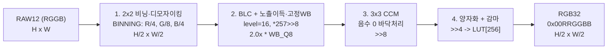

# LowlightISP — 저조도용 ISP 재구성 모듈(RM) 설명서

> **대상 파일:** `LowlightISP.hpp`, `LowlightISP.cpp`  
> **역할:** 어두운 장면에서 재구성 영역(RP)에 탑재되는 2×2 비닝·고이득($H/2 \times W/2$) 정수 ISP 모듈  
> **회귀 검증 벡터:** `../vectors/LowlightISP_vectors.csv` (독립 Python 구현 기반 비트 일치 픽스처)

---

## 1. 설계 의도 및 `NormalISP` 대비 구조적 차이

저조도 RAW 영상은 광자 산탄 잡음과 읽기 잡음으로 SNR이 낮다. `LowlightISP`는 이를 하드웨어 구조로 대응하기 위해 `NormalISP`와 다음 측면에서 다르게 설계되었다.

- **2×2 비닝·디모자이킹 결합:** 인접한 2×2 RGGB 셀의 동일 색 화소를 평균해 SNR을 높이고, 동시에 출력 해상도를 가로·세로 절반으로 줄여 연산량과 메모리 대역폭을 절감한다.
- **적응형 AWB 생략 및 노출 이득 결합:** 저조도에서는 프레임 평균 기반 AWB가 잡음에 불안정하고 추가 프레임 스캔이 필요하므로, 2.0× 노출 이득(`EXPOSURE_GAIN_Q8=512`)과 고정 화이트 밸런스(`WB_R/G/B`)를 결합해 단일 패스로 처리한다.
- **야간 최적 블랙 레벨 적용:** `BLC_LEVEL12`를 기존 `32`에서 2026-10-14 보드 실측 야간 최적값인 `16`($1 \ll 4$)으로 낮춰 암부 신호 손실을 줄였다.
- **단일 패스 파이프라이닝:** 내측 화소 루프에 `#pragma HLS PIPELINE II=1`을 적용하고, 모든 연산을 정수(bit-exact)로 구현했다.

---

## 2. 처리 파이프라인



---

## 3. 단계별 동작 및 수식 상세

### 3.1 `LowlightISP.hpp` — 인터페이스 및 RP 슬롯 계약

- **열거형 `LowlightISPBinning`:**
  - <kbd>LOWLIGHT_ISP_BIN_SUBSAMPLE (0)</kbd>: 단일 RGGB 셀만 추출하는 서브샘플링 모드
  - <kbd>LOWLIGHT_ISP_BIN_BINNING (1)</kbd>: 2×2 인접 RGGB 셀을 평균하는 비닝 모드
- **최상위 함수:**
  - `LowlightISP_dev(...)`: 개발·분석용 최상위로 `bin_mode`를 런타임에 선택할 수 있다.
  - `LowlightISP(...)`: 보드·DFX RM 최상위로 `LOWLIGHT_ISP_BIN_BINNING`을 고정 사용한다. **`NormalISP()`와 6개 매개변수의 타입·순서·개수가 완전히 동일**해 동일 RP 슬롯에 교체 탑재할 수 있다.

```cpp
extern "C" void LowlightISP(
    const uint16_t* raw_bayer, uint32_t* rgb_out,
    int width, int height, int* out_width, int* out_height);
```

### 3.2 `LowlightISP.cpp` — 함수별 구현 설명

1. **출력 해상도 계산 (`bin_dim`)**
   - 홀수 또는 `1×1` 입력에서도 최소 `1`을 보장한다.
     $$W_{\text{out}} = \max\!\left(1,\; \lfloor W/2 \rfloor\right), \qquad H_{\text{out}} = \max\!\left(1,\; \lfloor H/2 \rfloor\right)$$

2. **단일 셀 읽기 및 2×2 비닝·디모자이킹 (`cell_sites`, `binned_raw`) — 1단계**
   - `cell_sites`: 셀 좌표 `(cx, cy)`에서 RGGB 4화소 `(r, g0, g1, b)`를 읽으며, 홀수 경계에서는 `width - 1`, `height - 1`로 클램핑한다.
   - `binned_raw`:
     - <kbd>SUBSAMPLE (0)</kbd>: 단일 RGGB 셀에서 $R = r,\; G = \lfloor(g_0 + g_1)/2\rfloor,\; B = b$를 산출한다.
     - <kbd>BINNING (1)</kbd>: 출력 좌표 `(bx, by)` 기준 2×2 인접 셀(`dx, dy ∈ {0, 1}`, 경계는 `[0, bw-1]`, `[0, bh-1]`로 클램핑)을 합산해 동일 색 평균을 구한다.
       $$R_{12} = \left\lfloor \frac{\sum r}{4} \right\rfloor, \qquad G_{12} = \left\lfloor \frac{\sum (g_0 + g_1)}{8} \right\rfloor, \qquad B_{12} = \left\lfloor \frac{\sum b}{4} \right\rfloor$$

3. **RGB 도메인 BLC 및 노출 이득·고정 WB (`correct_channel`, `binned_rgb`) — 2단계**
   - 각 채널(R/G/B)에 대해 `BLC_LEVEL12 = 16`($1 \ll 4$)을 차감하고 동적 범위를 복원한다.
     $$v_1 = \text{clip}\!\left(\left\lfloor \frac{\max(v - 16,\; 0) \cdot 257}{256} \right\rfloor,\; 0,\; 4095\right), \qquad \texttt{BLC\_MUL\_Q8} = \text{round}\!\left(\frac{256 \times 4095}{4095 - 16}\right) = 257$$
   - 이어 2.0× 노출 이득(`EXPOSURE_GAIN_Q8 = 512`)과 채널별 고정 WB(`R=286, G=256, B=307`)를 결합해 적용한다.
     $$g_{\text{Q8}} = \left\lfloor \frac{512 \cdot \text{wb}_{\text{Q8}}}{256} \right\rfloor, \qquad v_2 = \text{clip}\!\left(\left\lfloor \frac{v_1 \cdot g_{\text{Q8}}}{256} \right\rfloor,\; 0,\; 4095\right)$$

4. **색 보정 행렬 (`ccm_channel`) — 3단계**
   - `NormalISP`와 동일한 Q8 3×3 행렬 `CCM_Q8`을 적용하며, 우시프트(`>> 8`) 전 음수 누적값을 `0`으로 바닥 처리해 비트 일치를 보장한다.

5. **양자화 및 감마 보정 (`apply_gamma`) — 4단계**
   - `ccm_channel` 출력이 이미 `[0, 4095]`로 클램핑되어 있으므로 `v12 >> 4`로 8비트 인덱스를 얻어 `GAMMA2_LUT`($\lfloor\sqrt{255 \cdot v_8}\rfloor$, `NormalISP`와 바이트 동일)를 조회하고 `pack_rgb`로 `0x00RRGGBB`를 패킹한다.

6. **메인 루프 및 안전 가드 (`run_lowlight_isp`, `LowlightISP_dev`, `LowlightISP`)**
   - 내측 `bx` 루프에 `#pragma HLS PIPELINE II=1`을 적용해 출력 화소당 1사이클 처리율(목표 II=1)로 합성한다.
   - `raw_bayer` 또는 `rgb_out`이 null이거나 `width <= 0`, `height <= 0`이면 즉시 반환하며 `out_width = out_height = 0`을 기록한다.

---

## 4. 핵심 상수 및 HLS 인터페이스

### 핵심 상수 요약

| 상수 | 값 | 의미 |
|---|---|---|
| `RAW12_MAX` | `4095` | 12비트 RAW 최대값 |
| `BLC_LEVEL12` / `BLC_MUL_Q8` | `16` (`1<<4`) / `257` | 12비트 야간 최적 블랙 레벨(2026-10-14 변경) 및 범위 복원 Q8 계수 |
| `EXPOSURE_GAIN_Q8` | `512` | 저조도 노출 이득 (2.0×, Q8) |
| `WB_R_Q8` / `WB_G_Q8` / `WB_B_Q8` | `286` / `256` / `307` | 채널별 고정 화이트 밸런스 (Q8, `NormalISP`와 동일 크기) |
| `CCM_Q8` | `{{288,-24,-8},{-24,296,-16},{-16,-32,304}}` | Q8 3×3 색 보정 행렬 (행 합 256) |
| `GAMMA2_LUT[256]` | `0..255` | $\gamma = 2.0$ 정수 256엔트리 LUT (`NormalISP`와 바이트 동일) |

### HLS 인터페이스 및 프래그마

- **메모리 포트 (`m_axi`):** `raw_bayer` (`bundle=gmem0`, `offset=slave`, `depth=2048`), `rgb_out` (`bundle=gmem1`, `offset=slave`, `depth=2048`)
- **제어 레지스터 (`s_axilite`, `bundle=control`):** `raw_bayer`, `rgb_out`, `width`, `height`, (`bin_mode`, `_dev` 전용), `out_width`, `out_height`, `return`
- **파이프라인·루프 힌트:** 내측 루프 `#pragma HLS PIPELINE II=1`, `LOOP_TRIPCOUNT` by `min=1 max=540`, bx `min=2 max=960` / 내부 보조 함수 `#pragma HLS INLINE`
