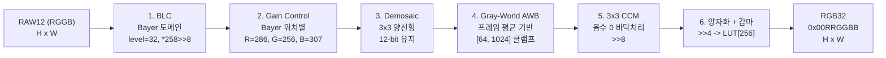

# NormalISP — 일반 조도용 ISP 재구성 모듈(RM) 설명서

> **대상 파일:** `NormalISP.hpp`, `NormalISP.cpp`  
> **역할:** 밝은 장면에서 재구성 영역(RP)에 탑재되는 표준 풀해상도($H \times W$) 정수 ISP 모듈  
> **회귀 검증 벡터:** `../vectors/NormalISP_vectors.csv` (독립 Python 구현 기반 비트 일치 픽스처)

---

## 1. 설계 배경 및 Vitis Vision 레퍼런스 대비 특징

`NormalISP`는 AMD Vitis Vision Library L3 `isppipeline` 예제의 **단계 순서와 연산 도메인**을 따르는 일반 조도용 기준 ISP 모듈이다.

- **구조적 차별성:** 기존 초기 구조는 디모자이킹 이후 RGB 도메인에서 고정 화이트 밸런스와 단위 CCM을 적용했으나, `NormalISP`는 디모자이킹 이전 **Bayer 도메인에서 BLC와 위치별 이득 제어**를 수행하고, 디모자이킹 후 **적응형 Gray-World AWB**와 **실제 3×3 CCM**을 적용한다.
- **Vitis Vision 레퍼런스와의 차이점:**
  - **12→8비트 양자화:** 단순 우시프트(`>> 4`)를 사용하며, 선택적 디더링(dithering)은 생략했다.
  - **출력 색공간 변환(`rgb2yuyv`) 생략:** 후단 DPU 객체 검출기가 RGB 입력을 직접 소비하므로 `0x00RRGGBB` 패킹 RGB888로 출력한다.
  - **AWB 통계 산출 방식:** Vitis 예제는 직전 프레임 히스토그램(1프레임 지연·더블 버퍼)을 사용하지만, 본 구현은 현재 프레임의 보정된 Bayer 평균을 1차 스캔으로 누적한다. 프레임 버퍼와 1프레임 지연이 사라지는 대신 `raw_bayer`를 1회 추가 읽기한다.
- **정수 연산 보장:** 모든 산술은 정수(bit-exact)로 구현해 `../vectors/NormalISP_vectors.csv`와 비트 단위로 일치한다.

---

## 2. 처리 파이프라인



---

## 3. 단계별 동작 및 수식 상세

### 3.1 `NormalISP.hpp` — 인터페이스 및 RP 슬롯 계약

- **열거형 `NormalISPAwbMode`:**
  - <kbd>NORMAL_ISP_AWB_OFF (0)</kbd>: AWB 바이패스 (Bayer 도메인 이득 제어만 적용)
  - <kbd>NORMAL_ISP_AWB_ON (1)</kbd>: 프레임별 적응형 Gray-World AWB 적용
- **최상위 함수:**
  - `NormalISP_dev(...)`: 개발·분석용 최상위로 `awb_mode`를 런타임에 전환할 수 있다.
  - `NormalISP(...)`: 보드·DFX RM 최상위로 `NORMAL_ISP_AWB_ON`을 고정 사용한다. **`LowlightISP()`와 6개 매개변수의 타입·순서·개수가 완전히 동일**해 단일 DFX RP 슬롯에 상호배타적으로 교체 탑재할 수 있다.

```cpp
extern "C" void NormalISP(
    const uint16_t* raw_bayer, uint32_t* rgb_out,
    int width, int height, int* out_width, int* out_height);
```

### 3.2 `NormalISP.cpp` — 함수별 구현 설명

1. **보조 함수 (`clamp_i`, `pack_rgb`, `bayer_gain_q8`)**
   - `clamp_i(v, lo, hi)`: 정수 범위 클램핑
   - `pack_rgb(r, g, b)`: 8비트 R/G/B를 `0x00RRGGBB` 32비트 워드로 패킹
   - `bayer_gain_q8(x, y)`: RGGB 배열 `(0,0)=R, (0,1)=G, (1,0)=G, (1,1)=B`에 따라 R=`286`, B=`307`, G=`256`(기준 채널) Q8 이득을 반환한다. `LowlightISP`의 고정 WB 계수와 크기가 동일하며, 적용 도메인(Bayer vs RGB)만 다르다.

2. **Bayer 도메인 보정 (`corrected_bayer`) — 1·2단계**
   - 전체 프레임 버퍼를 두지 않고 윈도우 읽기 시점에 즉석(on-the-fly)으로 점별 보정을 수행한다(경계 외 좌표는 `[0, width-1]`, `[0, height-1]`로 복제).
   - **1단계 BLC:** 2026-07-20 실센서 RAW 재보정값 `BLC_LEVEL12 = 32`($2 \ll 4$)를 차감한 뒤 손실된 동적 범위를 복원한다.
     $$v_1 = \text{clip}\!\left(\left\lfloor \frac{\max(v - 32,\; 0) \cdot 258}{256} \right\rfloor,\; 0,\; 4095\right), \qquad \texttt{BLC\_MUL\_Q8} = \text{round}\!\left(\frac{256 \times 4095}{4095 - 32}\right) = 258$$
   - **2단계 Bayer 이득 제어:** 위치별 Q8 이득을 곱하고 `>> 8` 후 `[0, 4095]`로 클램핑한다.

3. **디모자이킹 (`demosaic_rggb12`) — 3단계**
   - `corrected_bayer`로 3×3 윈도우를 구성해 RGGB 4가지 사이트(R, R행 G, B행 G, B)별 양선형 보간을 수행하며 12비트 정밀도를 유지한다. `LowlightISP`와 동일한 보간 계열을 사용해 두 모듈 간 비교가 파이프라인 구조 차이에 집중되도록 설계했다.

4. **적응형 AWB (`awb_gains_q8`) — 4단계**
   - `AWB_ON` 시 프레임 전체를 1차 스캔해 보정된 Bayer 값의 R/G/B 채널별 평균($\bar{R}, \bar{G}, \bar{B}$)을 계산한다.
   - G 채널을 기준(이득 256 고정)으로 R·B 이득을 산출하고 `[64, 1024]`(0.25×~4.0×)로 클램핑한다. 평균이 0인 채널은 안전하게 `256`을 사용한다.
     $$g_R = \text{clip}\!\left(\left\lfloor \frac{256 \cdot \bar{G}}{\bar{R}} \right\rfloor,\; 64,\; 1024\right), \qquad g_B = \text{clip}\!\left(\left\lfloor \frac{256 \cdot \bar{G}}{\bar{B}} \right\rfloor,\; 64,\; 1024\right)$$

5. **색 보정 행렬 (`ccm_channel`) — 5단계**
   - Q8 3×3 행렬 `CCM_Q8`을 적용한다. 각 행의 합이 `256`이므로 무채색(회색)이 보존된다.
   - 음수 계수로 누적값 `acc`가 음수가 될 수 있으므로, 우시프트(`>> 8`) 전에 `if (acc < 0) acc = 0;`으로 바닥 처리해 C++와 Python 간 음수 산술 시프트 차이를 원천 차단한다.

> [!NOTE]
> `CCM_Q8`은 경미한 채도 복원을 위한 고정 행렬이며, 엄밀한 색 정확도 검증이 필요할 경우 센서별 캘리브레이션 행렬로 교체해야 한다.

6. **양자화 및 감마 보정 (`quantize_gamma`) — 6·7단계**
   - 12비트 값을 `[0, 4095]`로 클램핑 후 `>> 4`로 8비트 인덱스(`0..255`)를 만들고, 256엔트리 ROM `GAMMA2_LUT`를 조회한다.
     $$\text{GAMMA2\_LUT}[v_8] = \lfloor \sqrt{255 \cdot v_8} \rfloor$$
   - `LowlightISP`의 `GAMMA2_LUT`와 바이트 단위로 동일해 감마 축의 비교 공정성을 유지한다(실리콘에서는 각 RM이 독립 ROM을 소유).

7. **메인 루프 및 안전 가드 (`run_normal_isp`, `NormalISP_dev`, `NormalISP`)**
   - `raw_bayer` 또는 `rgb_out`이 null이거나 `width <= 0`, `height <= 0`이면 즉시 반환하며 `out_width = out_height = 0`을 기록한다.
   - 정상 입력 시 입력 해상도와 동일한 `out_width = width`, `out_height = height`를 기록한다.

---

## 4. 핵심 상수 및 HLS 인터페이스

### 핵심 상수 요약

| 상수 | 값 | 의미 |
|---|---|---|
| `RAW12_MAX` | `4095` | 12비트 RAW 최대값 |
| `BLC_LEVEL12` / `BLC_MUL_Q8` | `32` (`2<<4`) / `258` | 12비트 블랙 레벨 및 범위 복원 Q8 계수 |
| `GAIN_R_Q8` / `GAIN_B_Q8` | `286` / `307` | Bayer 도메인 R/B 고정 이득 (G=256 기준) |
| `AWB_GAIN_MIN_Q8` / `MAX_Q8` | `64` / `1024` | Gray-World AWB 이득 클램프 범위 (0.25×~4.0×) |
| `CCM_Q8` | `{{288,-24,-8},{-24,296,-16},{-16,-32,304}}` | Q8 3×3 색 보정 행렬 (행 합 256) |
| `GAMMA2_LUT[256]` | `0..255` | $\gamma = 2.0$ 정수 256엔트리 LUT |

### HLS 인터페이스 및 프래그마

- **메모리 포트 (`m_axi`):** `raw_bayer` (`bundle=gmem0`, `offset=slave`, `depth=2048`), `rgb_out` (`bundle=gmem1`, `offset=slave`, `depth=2048`)
- **제어 레지스터 (`s_axilite`, `bundle=control`):** `raw_bayer`, `rgb_out`, `width`, `height`, (`awb_mode`, `_dev` 전용), `out_width`, `out_height`, `return`
- **루프 힌트:** `LOOP_TRIPCOUNT` y `min=4 max=1080`, x `min=4 max=1920` / 내부 보조 함수 `#pragma HLS INLINE`
